# 에드워드 2차 리워크 (PR 설명 그림판)

에드워드 2차 리워크입니다 ([`docs/motions/애니메이션재수정지침.md`](../../docs/motions/애니메이션재수정지침.md) 2·3·4·5장). 점검표의 **C 등급 4개를 먼저, 그다음 B 등급**을 다시 깎았습니다. 보호 목록(필살기 껍데기 뒤집어쓰기와 그 연출 6개)은 손대지 않았습니다.

**바꾼 것은 그림뿐입니다.** 판정·캔슬·몸 이동(공격 데이터)과 이펙트 코드는 그대로입니다. 아래 확인에서 게임 결과가 한 판도 달라지지 않았고, 해머 머리와 판정 상자, 그림과 피격 상자의 차이도 모두 8px 안입니다.

> #40(백은우)·#41·#42가 머지된 뒤 최신 main 위로 옮겨 다시 확인했습니다. 아래 확인은 최신 main과 맞댄 결과입니다.
>
> 라이덴(#39)·백은우(#40)는 번호 답 없이 머지되어서 아직 승인목록·보호 목록에 적지 않았습니다. 그 번호도 여기에 같이 답해 주시면 함께 적겠습니다.

**답하는 법**: 번호로 답해 주세요. 예: "3 좋아, 6 감기 더 길게". 좋다고 한 것은 `docs/motions/승인목록.md`와 지침 1장 보호 목록에 적겠습니다.

## 한눈에

에드워드 40개 가운데 31개를 다시 깎았습니다. 점검표 등급은 **A 2 → 32**, **B 34 → 8**, **C 4 → 0**으로 바뀌었습니다. 남은 B 8개는 보호 목록 7개와 벽 달리기(30)입니다.

| 번호 | 동작 | 프레임 (전 → 후) | 총 틱 | 등급 (전 → 후) |
| --- | --- | --- | --- | --- |
| 1 | 방어 | 12 → 7 | 12 | C (복사·눌림·간격·2차) → A |
| 2 | 쓸기 바닥 쓸기 | 13 → 17 | 36 | C (복사·눌림·2차·지나치기·직선) → A |
| 3 | 대시 공격 돌진 휘두르기 | 13 → 16 | 33 | C (복사·눌림·2차·지나치기) → A |
| 4 | 스킬 2 염동력 끌어당김 | 14 → 17 | 48 | C (복사·눌림·감기 없음·지나치기) → A |
| 5 | 스킬 2 염동력 밀어냄 | 14 → 17 | 48 | B (복사·눌림·2차) → A |
| 6 | 1타 가로 휘두르기 | 14 → 17 | 43 | B (눌림·2차) → A |
| 7 | 2타 되돌려 휘두르기 | 14 → 17 | 43 | B (눌림) → A |
| 8 | 3타 머리 위로 돌려 내려찍기 | 14 → 17 | 44 | B (눌림·2차) → A |
| 9 | 4타 한 바퀴 풀스윙 | 14 → 17 | 48 | B (눌림) → A |
| 10 | 띄우기 퍼 올리기 | 13 → 16 | 36 | B (눌림·2차) → A |
| 11 | 차지 워 해머 올려치기 | 14 → 19 | 62 | B (눌림) → A |
| 12 | 공중 1타 내려치기 | 14 → 16 | 34 | B (눌림·2차) → A |
| 13 | 공중 2타 퍼 올리기 | 14 → 16 | 34 | B (눌림) → A |
| 14 | 공중 3타 내려쳐 떨어뜨리기 | 14 → 17 | 42 | B (눌림·2차) → A |
| 15 | 내려찍기 | 14 → 17 | 44 | B (눌림·2차) → A |
| 16 | 벽 박차기 공격 | 13 → 14 | 33 | B (2차·감기 없음) → A |
| 17 | 스킬 1 재현:나 | 13 → 16 | 34 | B (복사·눌림·2차) → A |
| 18 | 대기 | 14 → 10 | 120 | B (복사·2차) → A |
| 19 | 앞 걷기 | 14 → 14 | 70 | B (간격) → A |
| 20 | 뒤 걷기 | 14 → 14 | 64 | B (간격) → A |
| 21 | 점프 | 12 → 12 | 24 | B (2차) → A |
| 22 | 낙하 | 12 → 6 | 36 | B (간격·2차) → A |
| 23 | 착지 | 12 → 8 | 12 | B (모두 1틱·2차) → A |
| 24 | 공중 대시 | 12 → 8 | 12 | B (모두 1틱·2차) → A |
| 25 | 방어 막힘 | 12 → 7 | 12 | B (복사·모두 1틱·2차) → A |
| 26 | 등장 | 14 → 14 | 80 | B (복사) → A |
| 27 | 승리 | 14 → 8 | 51 | B (복사·2차) → A |
| 28 | 벽 붙기 | 13 → 9 | 36 | B (복사) → A |
| 29 | 벽 점프 | 14 → 14 | 26 | B (2차) → A |
| 30 | 벽 달리기 | 14 → 14 | 39 | B (간격·2차) → B (간격) |
| 31 | 벽 낙법 | 13 → 13 | 28 | B (2차) → A |

### 고치지 않고 둔 B (이유)

| 동작 | 남은 신호 | 이유 |
| --- | --- | --- |
| 벽 달리기 (30) | 간격 | 걸음을 "딛음 → 내려앉음 → 끌어 올림" 세 박자로 바꾸면 A가 되지만, 예전 피격 시간표(발을 바꾸는 사이 프레임에서 두 발이 모두 벽에서 떨어져 있음)와 그림이 10~11px 어긋난다. 이번에는 피격 상자 차이 8px 안을 지켰다. 원하시면 세 박자 판으로 바꾸겠다 |

## 에드워드 몸의 언어 (3장)를 이렇게 옮겼습니다

- **무게. 해머 머리가 가장 늦게 따라온다**
  - 휘두르기는 "허리·어깨가 먼저 풀리고 손과 해머는 뒤에 남는 프레임 → 손이 먼저 앞으로, 머리는 처짐 → 타격에서 머리가 손을 따라잡음" 순서다. 쓸기·대시 공격·1~4타·공중 1~3타·내려찍기(2·3·6~9·12~15)의 점검표 ④가 "팔꿈치·손 6 → 해머 머리 7"로 나온다.
  - 스킬 1(17)과 이동·연출(18~31)도 몸이 먼저 움직이고 어깨 위 해머가 한 박자 늦게 들썩인다. 점검표 "2차 동작 없음"이 벽 달리기를 포함해 모두 풀렸다.
- **친 뒤에는 몸이 해머에 끌려간다**: 지나치기 프레임에서 머리가 더 쏠리며 몸이 끌려 나간다. 쓸기·대시 공격·4타(2·3·9)는 뒷발 뒤꿈치가 들리고, 공중 1~3타(12~14)는 몸이 해머에 끌려 돈다.
- **엉덩이 높이가 크게 출렁이고, 디딜 때마다 2px 내려앉는다**: 휘두르기의 엉덩이 높이 출렁임 9~14px. 여운·착지·해머를 바닥에 세울 때 2px 내려앉는 프레임을 따로 두었다.
- **감기가 길다(`stop` 6~8틱)**: 1~4타·공중 3타는 감기 끝 7틱, 쓸기·대시 공격·공중 1·2타는 6틱 멈춤. 발동이 10~11틱인 띄우기·염동력과 공중에 멈추는 내려찍기는 5틱.
- **회복이 느리다**: 회복은 "무게가 먼저 뒤로 빠짐 → 해머를 들어 → 어깨로 → 내려앉음"으로 4~5장이고, 점검표 ⑦(처음 빠르고 끝으로 느리게)이 휘두르기 모두에 나온다.

## 확인 (5장)

**sim이 바꾸기 전과 같습니다.**
- `npm run simtest`: 모두 통과, 출력(CPU 대전 해시 포함)이 최신 main과 같습니다.
- 같은 시드 자동 대전(`npm run hitcompare`, 5캐릭터 모든 짝 · 양쪽 자리 · 시드 4개 = 100판): 결과 JSON이 최신 main과 같습니다(저장 경로 줄만 다름).

| 캐릭터 | 맞힘 (전 → 후) | 막힘 (전 → 후) | 크러시 (전 → 후) | 준 피해 합계 (전 → 후) |
| --- | --- | --- | --- | --- |
| 라이덴 | 2526 → 2526 | 902 → 902 | 46 → 46 | 75829 → 75829 |
| 백은우 | 1138 → 1138 | 453 → 453 | 9 → 9 | 72963 → 72963 |
| 에드워드 | 1040 → 1040 | 703 → 703 | 157 → 157 | 57801 → 57801 |
| 오스카 | 1289 → 1289 | 1002 → 1002 | 79 → 79 | 62968 → 62968 |
| 기본 스틱맨 | 1576 → 1576 | 329 → 329 | 6 → 6 | 61735 → 61735 |

**바뀐 그림은 에드워드 31개뿐입니다.** 220개 동작의 관절·표시 틱을 최신 main과 하나하나 맞댔습니다. 보호 목록과 다른 캐릭터 동작은 그대로입니다.

**그림과 판정의 차이 (4장)**: 8px 넘게 어긋난 곳은 없습니다.
- 해머 판정은 해머 머리가 지나는 길을 감싼 궤적 상자입니다. 판정 틱마다 그림 해머 머리가 상자 밖으로 나간 거리를 쟀습니다(염동력은 뒷손, 내려찍기의 떨어지는 판정은 몸).
  - 벽 박차기만 상자 밖으로 나갑니다: 전 6.1 / 1.7 / 5.5 / 6 / 6 / 5px → 후 6.1 / 6.6 / 2.9 / 3.6 / 4.6 / 5px.
  - 나머지 기술은 판정 틱 내내 상자 안(0px)입니다.
- 피격 상자의 가장 큰 차이는 8px입니다(1타 · 낙하 · 내려찍기).
- 휘두르기의 타격 머리는 렌더의 청동빛 원호(`EDWARD_ARCS`·`CHARGE_ARC`) 위 그대로 두었습니다.

**이펙트가 새 자세를 따라가는지** 게임 화면으로 확인했습니다(`npm run moveclip`). 결과는 아래 "이펙트 확인"에 있습니다.

**네 캐릭터 같은 공격의 타격 프레임** (첫 판정 틱):

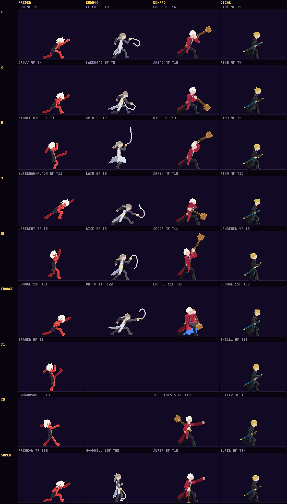

**실루엣 띠**: [silhouette-edward.png](../motions/silhouette-edward.png) · 점검표 [`docs/motions/점검표.md`](../../docs/motions/점검표.md)

## 동작별 (GIF는 왼쪽 BEFORE · 오른쪽 NOW, 같은 자리·실제 속도, 판정 상자 없음, 판정 틱에 HIT)

보는 법:
- **일곱 요소**: ①은 치는 쪽 어깨 − 엉덩이(px, 앞이 +), ②는 엉덩이가 첫 프레임에서 옮겨 간 거리입니다(점검표 도구 값). ④는 가장 빨라지는 프레임, ⑥은 해머 머리가 더 나갔다(+) 돌아온(−) 거리입니다.
- **링크**: 0.5배속 GIF, 끝점 경로(회색 = 전, 노랑 = 지금, 점 옆 숫자 = 프레임), 단색 실루엣 띠(위 = 전, 아래 = 지금, 빨강 = 첫 판정 프레임)입니다.
- 프레임 번호는 1부터 셉니다.

### 1. 방어 `edward/guard` — 12 → 7프레임 (12틱), C (복사·눌림·간격·2차) → A

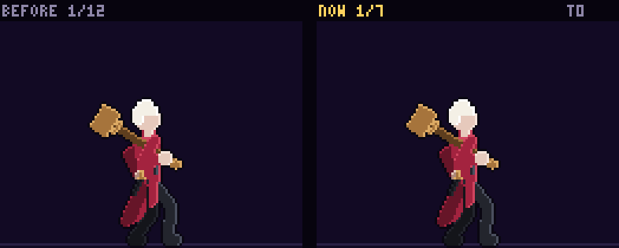

[0.5배속](edward-guard-compare-half.gif) · [끝점 경로](edward-guard-path.png) · [실루엣 띠](edward-guard-sil.png)

- **바꾼 것**: 손이 먼저 해머를 어깨에서 들고(머리는 어깨 뒤에 처짐) → 몸 앞으로 끌어내리며 뒷손이 손잡이를 잡음 → 머리 무게에 손잡이가 앞으로 넘어갔다(지나치기, 몸이 끌려 숙임) → 버텨 세우며 2px 내려앉음 → 숨을 고르며 막기 자세. sim은 그대로 마지막 프레임에 머뭅니다.
- **일곱 요소**: 해당 없음 — 공격이 아님
- **프레임 수**: 7장. 같은 자세 6장을 늘어놓던 12장 × 1틱 대신, 무게가 실리는 박자만큼.

### 2. 쓸기 바닥 쓸기 `edward/sweep` — 13 → 17프레임 (36틱), C (복사·눌림·2차·지나치기·직선) → A

[0.5배속](edward-sweep-compare-half.gif) · [끝점 경로](edward-sweep-path.png) · [실루엣 띠](edward-sweep-sil.png)

- **바꾼 것**: 해머를 내려 몸 뒤 바닥에 떨구며 웅크림 → 감기 끝 6틱 멈춤(엉덩이 4px 뒤로) → 허리·어깨가 먼저 풀리고 손은 뒤에 → 손이 허리 앞으로, 머리는 뒤 바닥에 끌리다 손을 앞질러 정강이 높이를 가로지름 → 머리가 앞 위로 쏠리며 몸이 끌려 나감 → 여운 → 무게가 먼저 뒤로 빠진 뒤 해머를 들어 어깨로.
- **일곱 요소**: ① 4→7(어깨 5→15px) · ② 4(엉덩이 −5)→7(+11), 높이 14 · ③ 어깨 5 < 손 6 · ④ 팔꿈치·손 6 → 해머 머리 7 · ⑤ 7(41° 꺾임: 낮게 엎드려 쓰는 동작이라 한 직선이 아님) · ⑥ 9(머리 +14 더 나감) · ⑦ 9~17
- **프레임 수**: 17장. 감기 4장(6틱 멈춤 포함) + 풀림·스미어 + 타격 2 + 지나치기 2 + 여운 2 + 복귀 5.

### 3. 대시 공격 돌진 휘두르기 `edward/rush` — 13 → 16프레임 (33틱), C (복사·눌림·2차·지나치기) → A

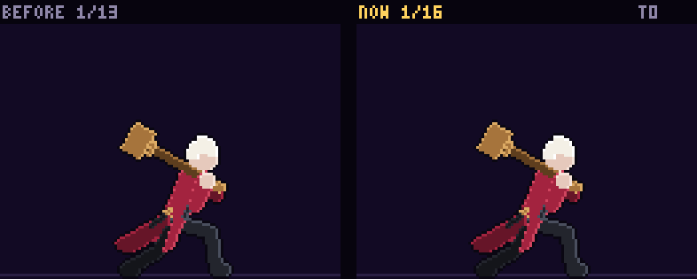

[0.5배속](edward-rush-compare-half.gif) · [끝점 경로](edward-rush-path.png) · [실루엣 띠](edward-rush-sil.png)

- **바꾼 것**: 돌진 → 앞발이 쿵(엉덩이 2px 내려앉음, 손이 먼저 해머를 듦) → 해머를 등 뒤 어깨 높이에 눕히고 6틱 멈춤 → 허리가 먼저 풀리고 손은 뒤에 → 손이 가슴 앞으로, 머리는 몸 옆 허리 아래로 처져 따라와 허리 앞을 가로질러 올라옴 → 앞 위로 쏠리며 몸이 끌려 나감 → 여운 → 무게가 뒤로 빠진 뒤 어깨로.
- **일곱 요소**: ① 4→7(1→12px) · ② 4(−2)→7(+6), 높이 9 · ③ 어깨 5 < 손 6 · ④ 팔꿈치·손 6 → 해머 머리 7 · ⑤ 7(44° 꺾임: 돌진하며 허리 높이를 가로지름) · ⑥ 9(+15/−5) · ⑦ 9~16
- **프레임 수**: 16장. 대시 공격은 발동 11틱이라 감기를 6틱 멈춤 한 장에 몰았다.

### 4. 스킬 2 염동력 끌어당김 `edward/telekinesis` — 14 → 17프레임 (48틱), C (복사·눌림·감기 없음·지나치기) → A

[0.5배속](edward-telekinesis-compare-half.gif) · [끝점 경로](edward-telekinesis-path.png) · [실루엣 띠](edward-telekinesis-sil.png)

- **바꾼 것**: 빈 뒷손을 엉덩이 뒤로 당겨 감고 멈춤(앞발을 넓게 디뎌 버팀) → 뒷어깨가 먼저 돌고 → 손이 아래에서 올라오는 호로 얼굴 높이까지 뻗음(10틱) → 몸이 기울며 손바닥이 4px 더 밀렸다가 주먹을 쥐며 되돌아옴(14틱) → 몸을 뒤로 젖혀 끌어당기고 끝에 2px 내려앉음 → 34틱에 손을 펴 떨어뜨림 → 천천히 주머니로. 어깨의 해머는 한 박자 늦게 들썩입니다.
- **일곱 요소**: 끝점은 뒷손(점검 도구 TIP) · ① 3→6(−4→11px) · ② 3(−2)→6(+4), 높이 3 · ③ 어깨 4 < 손 5 · ④ – (편 팔이 IK로 함께 펴져 팔꿈치·손 빠르기를 나눌 수 없음) · ⑤ 6(32°) · ⑥ 7(+5/−4) · ⑦ 8~17
- **프레임 수**: 17장. 스킬 참고값 16~30, 끌어당김(14~34틱)·놓음(34틱) 틱에 맞춰.

### 5. 스킬 2 염동력 밀어냄 `edward/tk_push` — 14 → 17프레임 (48틱), B (복사·눌림·2차) → A

[0.5배속](edward-tk_push-compare-half.gif) · [끝점 경로](edward-tk_push-path.png) · [실루엣 띠](edward-tk_push-sil.png)

- **바꾼 것**: 손바닥을 가슴 앞에 모아 웅크리고 멈춤 → 앞발을 내디디며 어깨가 먼저 → 끝까지 밀침(10틱, 장막 벽) → 한 번 더 밀렸다 2px 물러나 버팀(14틱) → 밀어붙이는 동안 뒷발이 미끄러지며 점점 낮게 → 34틱 장막이 터져 손이 위로 튕김 → 천천히 주머니로. 해머는 한 박자 늦게 들썩입니다.
- **일곱 요소**: 해당 없음 — 공격이 아님
- **프레임 수**: 17장. 끌어당김과 같은 박자(48틱).

### 6. 1타 가로 휘두르기 `edward/chop` — 14 → 17프레임 (43틱), B (눌림·2차) → A

[0.5배속](edward-chop-compare-half.gif) · [끝점 경로](edward-chop-path.png) · [실루엣 띠](edward-chop-sil.png)

- **바꾼 것**: 감기 끝 7틱 멈춤 → 허리·어깨가 먼저 풀리고 손과 해머는 머리 뒤에 남는 프레임을 더함 → 스미어에서 손이 가슴 앞으로, 머리는 처져 뒤따르다 타격에서 따라잡음 → 지나쳐 머리가 땅에 닿고 몸이 2px 내려앉음 → 무게가 먼저 뒤로 빠진 뒤(머리는 아직 땅에) 끌어 올려 어깨로.
- **일곱 요소**: ① 4→7(−7→11px) · ② 4(−3)→7(+7), 높이 9 · ③ 어깨 5 < 손 6 · ④ 팔꿈치·손 6 → 해머 머리 7 · ⑤ 7(14°, 한 직선) · ⑥ 8(+8.5/−3.4) · ⑦ 9~17
- **프레임 수**: 17장. 큰 휘두르기 참고값 16~24. 타격 머리는 이펙트 원호(ARC1) 위 그대로.

### 7. 2타 되돌려 휘두르기 `edward/swing` — 14 → 17프레임 (43틱), B (눌림) → A

[0.5배속](edward-swing-compare-half.gif) · [끝점 경로](edward-swing-path.png) · [실루엣 띠](edward-swing-sil.png)

- **바꾼 것**: 해머를 바닥에 끌어 등 뒤 아래로 감고 7틱 멈춤 → 반 걸음 내디디며 허리가 먼저 → 손이 허리 앞으로, 머리는 발밑을 스치며 처져 따라오다 타격에서 따라잡음 → 앞 위로 쏠림 → 치켜든 채 멈추며 2px 내려앉음 → 무게가 먼저 뒤로 빠진 뒤 어깨로.
- **일곱 요소**: ① 4→7(0→11px) · ② 4(−9)→7(+8), 높이 9 · ③ 어깨 5 < 손 6 · ④ 팔꿈치·손 6 → 해머 머리 7 · ⑤ 7(52° 꺾임: 낮게 올려 치는 동작) · ⑥ 8(+11/−8) · ⑦ 9~17
- **프레임 수**: 17장. 타격 머리는 이펙트 원호(ARC2) 위 그대로.

### 8. 3타 머리 위로 돌려 내려찍기 `edward/rise` — 14 → 17프레임 (44틱), B (눌림·2차) → A

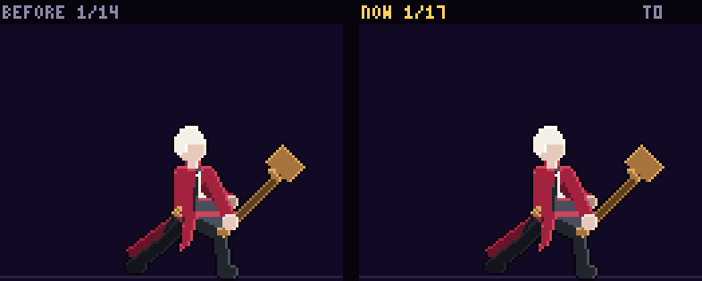

[0.5배속](edward-rise-compare-half.gif) · [끝점 경로](edward-rise-path.png) · [실루엣 띠](edward-rise-sil.png)

- **바꾼 것**: 두 손이 먼저 해머를 머리 위로 들고 다음 프레임에 등 뒤로 넘어감 → 젖혀 7틱 멈춤 → 허리가 먼저 접힘 → 손이 이마 앞으로, 머리는 처져 뒤따르다 타격에서 따라잡음 → 바닥에 박힘 → 박힌 채 버티며 2px 내려앉음(35틱까지) → 무게가 뒤로 빠진 뒤 뽑아 올리고, 손이 어깨로 온 다음 해머가 넘어감.
- **일곱 요소**: ① 4→7(−8→12px) · ② 4(−8)→7(+8), 높이 12 · ③ 어깨 5 < 손 6 · ④ 팔꿈치·손 6 → 해머 머리 7 · ⑤ 7(10°, 한 직선) · ⑥ 9(+20: 바닥에 박힘) · ⑦ 9~17
- **프레임 수**: 17장. 박힌 채 버티는 길이는 예전 피격 시간표(35틱)에 맞춤. 타격 머리는 ARC3 위 그대로.

### 9. 4타 한 바퀴 풀스윙 `edward/smash` — 14 → 17프레임 (48틱), B (눌림) → A

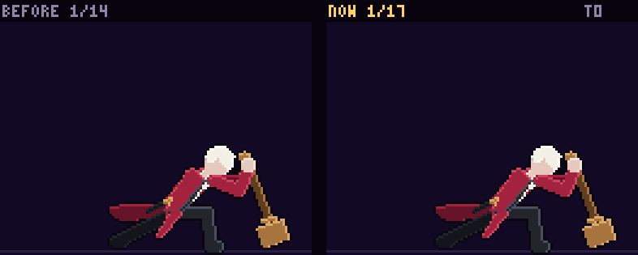

[0.5배속](edward-smash-compare-half.gif) · [끝점 경로](edward-smash-path.png) · [실루엣 띠](edward-smash-sil.png)

- **바꾼 것**: 두 손이 먼저 해머를 바닥에서 뽑아 끌고(머리는 바닥을 긁음) → 몸을 틀며 머리가 늦게 따라와 → 등을 보일 만큼 틀어 7틱 멈춤 → 허리가 먼저 풀림 → 손이 허리 앞으로, 머리는 몸 아래 뒤에 처져 휘돌다 타격에서 따라잡음 → 앞 위로 쏠리며 뒷발이 들림 → 치켜든 채 멈추며 2px 내려앉음(39틱까지) → 무게가 뒤로 빠진 뒤 어깨로.
- **일곱 요소**: ① 4→7(−6→12px) · ② 4(−12)→7(+11), 높이 11 · ③ 어깨 5 < 손 6 · ④ 팔꿈치·손 6 → 해머 머리 7 · ⑤ 7(63° 꺾임: 몸 아래를 휘도는 가로 스윙) · ⑥ 8(+21/−7.5) · ⑦ 9~17
- **프레임 수**: 17장. 타격 머리는 ARC4 위 그대로.

### 10. 띄우기 퍼 올리기 `edward/scoop` — 13 → 16프레임 (36틱), B (눌림·2차) → A

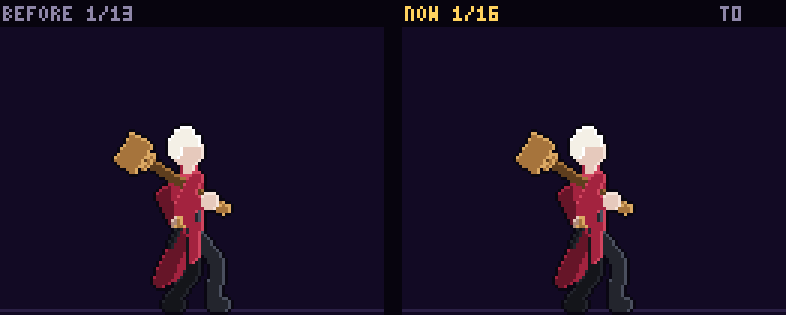

[0.5배속](edward-scoop-compare-half.gif) · [끝점 경로](edward-scoop-path.png) · [실루엣 띠](edward-scoop-sil.png)

- **바꾼 것**: 두 손이 먼저 해머를 들고 → 웅크리는 동안 해머는 아직 머리 위에 서 있다가 감기 끝(5틱 멈춤)에 발 앞 바닥에 쿵 떨어져 긁음 → 엉덩이가 먼저 솟음 → 손이 가슴 앞으로, 머리는 손 아래에 처짐 → 머리가 손을 앞질러 수직으로 솟구침(몸도 발끝까지) → 머리 위 뒤로 더 넘어감 → 발뒤꿈치가 내려와 내려앉음 → 어깨로.
- **일곱 요소**: ① – (수직으로 퍼 올리는 동작이라 어깨가 앞으로 나가지 않음) · ② 4(−2)→7(+7), 높이 13 · ③ 어깨 5 < 손 6 · ④ – (해머 머리가 가장 빠른 프레임이 바닥에 떨어지는 감기 4번) · ⑤ 7(14°, 한 직선) · ⑥ 9(+7.6) · ⑦ 9~16
- **프레임 수**: 16장. 발동 11틱 안에 감기 5틱 멈춤.

### 11. 차지 워 해머 올려치기 `edward/charge` — 14 → 19프레임 (62틱), B (눌림) → A

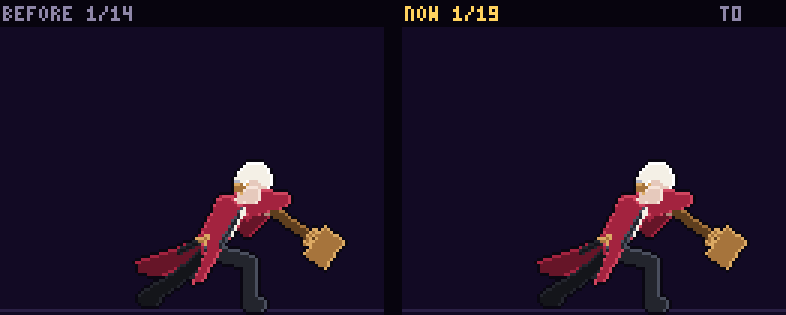

[0.5배속](edward-charge-compare-half.gif) · [끝점 경로](edward-charge-path.png) · [실루엣 띠](edward-charge-sil.png)

- **바꾼 것**: 1타 자세에서 두 손이 먼저 해머를 끌고 머리는 바닥에 대고 늦게 따라옴 → 몸 뒤 바닥에 닿으며 모으는 자세로 → 모으는 동안(12~28틱 되풀이) 두 자세를 번갈던 것을 "더 웅크려 바닥을 갊 → 어깨가 떨림 → 버텨 듦 → 처음으로" 네 장의 숨으로 → 떼면 무릎이 먼저 펴지고(28틱) 손이 앞으로 → 스미어(30틱 판정) → 앞 위로 큰 반원 → 머리 위로 치켜든 채(34틱부터 바닥이 솟구침) → 발뒤꿈치가 내려와 2px 내려앉음 → 어깨로.
- **일곱 요소**: ① – (아래에서 위로 올려치는 동작) · ② 7(−9)→11(+6), 높이 13 · ③ – · ④ – (모으는 자세에서 두 팔이 끝까지 뻗어 해머를 끌고 있어, 어깨가 움직이는 순간 손도 같이 끌려 나옴) · ⑤ 11(73° 꺾임) · ⑥ 12(+24/−4) · ⑦ 14~19
- **프레임 수**: 19장. 모으기 12~28틱·떼기 28틱·판정 30~34틱·솟구침 34틱 그대로. 끝 자세의 무기 각도를 한 바퀴 거꾸로 도는 −508° 대신 어깨로 바로 넘어가는 −148°로.

### 12. 공중 1타 내려치기 `edward/air_chop` — 14 → 16프레임 (34틱), B (눌림·2차) → A

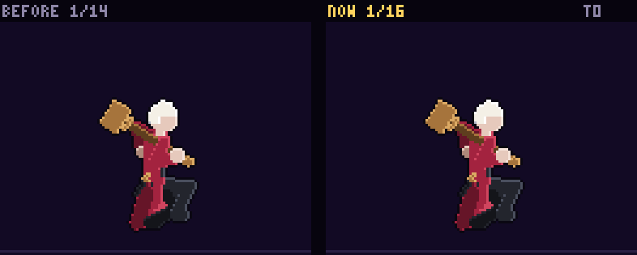

[0.5배속](edward-air_chop-compare-half.gif) · [끝점 경로](edward-air_chop-path.png) · [실루엣 띠](edward-air_chop-sil.png)

- **바꾼 것**: 해머를 머리 뒤로 들어 감고(머리는 손보다 늦게) 6틱 멈춤 → 허리가 먼저 접힘 → 손이 머리 앞 위로, 머리는 처져 뒤따르다 타격에서 따라잡음 → 해머 무게에 몸이 앞으로 끌려 돎 → 쏠림 → 여운(28틱까지) → 몸이 먼저 바로 서고, 두 손이 앞 위로 든 다음 해머가 넘어가 어깨로.
- **일곱 요소**: ① 4→7(−6→14px) · ② – (공중) · ③ 어깨 5 < 손 6 · ④ 팔꿈치·손 6 → 해머 머리 7 · ⑤ 7(17° 꺾임) · ⑥ 8(+10/−2.7) · ⑦ 9~16
- **프레임 수**: 16장. 타격 머리는 ARC_A1 위 그대로.

### 13. 공중 2타 퍼 올리기 `edward/air_swing` — 14 → 16프레임 (34틱), B (눌림) → A

[0.5배속](edward-air_swing-compare-half.gif) · [끝점 경로](edward-air_swing-path.png) · [실루엣 띠](edward-air_swing-sil.png)

- **바꾼 것**: 두 손이 먼저 허리로 내려가고 해머가 몸 뒤로 진자처럼 흔들려 내려가 감음(6틱 멈춤) → 어깨가 먼저 앞으로 → 손이 가슴 앞으로, 머리는 몸 아래에 처져 뒤따르다 타격에서 따라잡음 → 몸이 뒤로 젖혀지며 끌려 돎 → 여운(28틱까지) → 몸이 먼저 바로 서고 뒷손이 놓은 뒤 해머가 어깨로.
- **일곱 요소**: ① – (아래에서 위로 퍼 올리는 동작) · ② – (공중) · ③ 어깨 5 < 손 6 · ④ 팔꿈치·손 6 → 해머 머리 7 · ⑤ 7(106° 꺾임: 몸이 뒤로 젖혀지며 퍼 올림) · ⑥ 8(+11/−10) · ⑦ 9~16
- **프레임 수**: 16장. 타격 머리는 ARC_A2 위 그대로.

### 14. 공중 3타 내려쳐 떨어뜨리기 `edward/air_spin` — 14 → 17프레임 (42틱), B (눌림·2차) → A

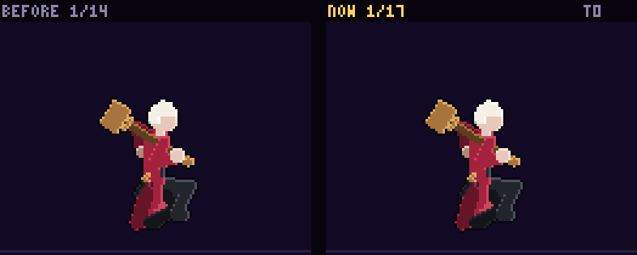

[0.5배속](edward-air_spin-compare-half.gif) · [끝점 경로](edward-air_spin-path.png) · [실루엣 띠](edward-air_spin-sil.png)

- **바꾼 것**: 머리 위로 크게 돌려 감고 7틱 멈춤 → 허리가 먼저 접힘 → 손이 머리 앞 위로, 머리는 처져 뒤따르다 타격에서 따라잡음 → 몸이 앞으로 한 바퀴 끌려 돎 → 쏠림 → 여운(32틱까지) → 몸이 먼저 바로 서고, 두 손이 앞 위로 든 다음 해머가 넘어가 어깨로.
- **일곱 요소**: ① 4→7(−10→15px) · ② – (공중) · ③ 어깨 5 < 손 6 · ④ 팔꿈치·손 6 → 해머 머리 7 · ⑤ 7(32° 꺾임) · ⑥ 8(+6/−8) · ⑦ 9~17
- **프레임 수**: 17장. 타격 머리는 ARC_A3 위 그대로.

### 15. 내려찍기 `edward/air_slam` — 14 → 17프레임 (44틱), B (눌림·2차) → A

[0.5배속](edward-air_slam-compare-half.gif) · [끝점 경로](edward-air_slam-path.png) · [실루엣 띠](edward-air_slam-sil.png)

- **바꾼 것**: 손이 먼저 해머를 머리 위로 치켜들고(머리는 늦게) → 공중에 멈춰 젖힘(5틱) → 무릎을 모아 매달림 → 15틱 다리가 먼저 아래로 뻗고 해머는 떨어지는 바람에 뒤로 젖혀졌다가 다시 섬(떨어지는 동안 머무는 프레임) → 20틱 착지하며 무릎이 먼저 꺾이고 해머 머리는 앞 위에 처졌다가 다음 프레임에 발 앞 바닥에 박힘 → 버티며 2px 내려앉음(35틱까지) → 무게가 먼저 뒤로 빠진 뒤 뽑아 올려 어깨로.
- **일곱 요소**: ① 4→6(−5→−1px: 떨어지는 몸이 판정이라 어깨 비틀림은 작음) · ② – (공중) · ③ – · ④ 팔꿈치·손 6 → 해머 머리 7 · ⑤ 6(11°) · ⑥ 8(착지에서 머리 +43: 바닥에 내리꽂음) · ⑦ 8~17 (땅에 서서 끝나 첫 공중 자세와 13px)
- **프레임 수**: 17장. slamDrop 15 · slamHold 20 · slamLand 20틱 그대로.

### 16. 벽 박차기 공격 `edward/wall_kick` — 13 → 14프레임 (33틱), B (2차·감기 없음) → A

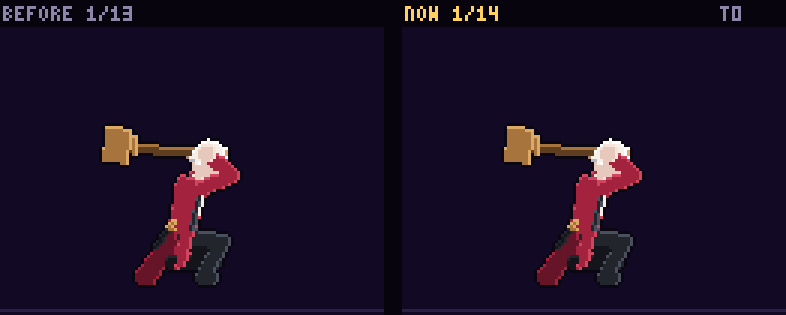

[0.5배속](edward-wall_kick-compare-half.gif) · [끝점 경로](edward-wall_kick-path.png) · [실루엣 띠](edward-wall_kick-sil.png)

- **바꾼 것**: 붙은 채 해머를 등 뒤 아래로 한 번 더 끌어당겨 감고 → 박차고 나가며 해머를 머리 뒤 위로 치켜듦(감기) → 손이 먼저 앞으로 내려오고 머리는 처진 프레임을 더함 → 7틱 내리침 → 머리가 한 번 더 쏠림(지나치기) → 내리친 채 날아감 → 손이 먼저 거두고 머리가 늦게 넘어와 낙하 자세로.
- **일곱 요소**: ① 3→5(5→9px) · ② 5(+4), 높이 6 · ③ – (박차는 순간 어깨·손이 같이 출발) · ④ 팔꿈치 4 → 손 5 → 해머 머리 5 · ⑤ 5(61° 꺾임: 아래 대각선으로 날며 내리침) · ⑥ 6(+2.9/−0.5) · ⑦ 11~14 (낙하 자세로 끝나 대기와 17px)
- **프레임 수**: 14장. 박차기 5틱·판정 7~23틱 그대로.

### 17. 스킬 1 재현:나 `edward/reenact` — 13 → 16프레임 (34틱), B (복사·눌림·2차) → A

[0.5배속](edward-reenact-compare-half.gif) · [끝점 경로](edward-reenact-path.png) · [실루엣 띠](edward-reenact-sil.png)

- **바꾼 것**: 손이 먼저 해머를 어깨에서 들어 머리 위로 → 두 손이 허리 앞으로 내려와 손잡이를 잡고 머리는 늦게 서 있다가 → 바닥에 쿵 세우며 2px 내려앉음 → 손잡이가 무게에 한 번 기울었다 돌아옴 → 두 손을 포개며 서서 숨을 들이쉬어 가슴을 펴고 턱을 듦(장막이 덮는다) → 내쉼 → 손이 먼저 뽑아 들고 머리가 늦게 넘어와 어깨에 걸침.
- **일곱 요소**: 해당 없음 — 공격이 아님
- **프레임 수**: 16장. 이펙트(장막·반짝)는 시작 틱 그대로.

### 18. 대기 `edward/idle` — 14 → 10프레임 (120틱), B (복사·2차) → A

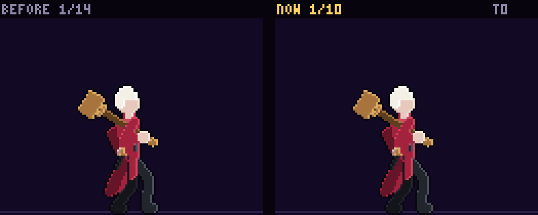

[0.5배속](edward-idle-compare-half.gif) · [끝점 경로](edward-idle-path.png) · [실루엣 띠](edward-idle-sil.png)

- **바꾼 것**: 들숨(가슴이 부푼 뒤 해머 머리가 늦게 들림) → 날숨(어깨가 내려앉은 뒤 머리가 늦게 내려앉음) → 해머로 어깨 툭(손이 먼저 내려오고 머리는 허공에 남았다가 늦게 어깨에 떨어짐) → 자리 잡음. 숨 한 바퀴 120틱 그대로.
- **일곱 요소**: 해당 없음 — 공격이 아님
- **프레임 수**: 10장. 같은 자세를 늘어놓던 4쌍을 dur로 쉬게.

### 19. 앞 걷기 `edward/walk_f` — 14 → 14프레임 (70틱), B (간격) → A

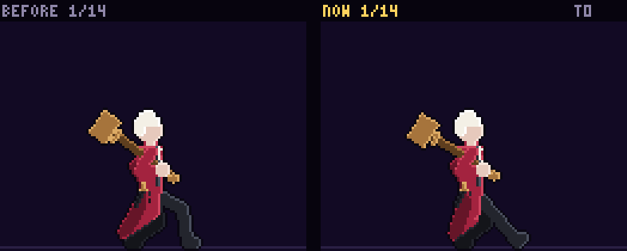

[0.5배속](edward-walk_f-compare-half.gif) · [끝점 경로](edward-walk_f-path.png) · [실루엣 띠](edward-walk_f-sil.png)

- **바꾼 것**: 발 하나가 딛는 프레임을 8 → 10, 드는 프레임을 6 → 4로: 오래 디디고 무겁게 한 번에 옮긴다(두 발이 함께 딛는 때가 길다). 디딜 때마다 엉덩이 2px 내려앉음은 그대로. 해머 머리는 어깨보다 두 박자 더 늦게 흔들립니다.
- **일곱 요소**: 해당 없음 — 공격이 아님
- **프레임 수**: 14장 그대로(거리로 프레임을 넘기는 동작).

### 20. 뒤 걷기 `edward/walk_b` — 14 → 14프레임 (64틱), B (간격) → A

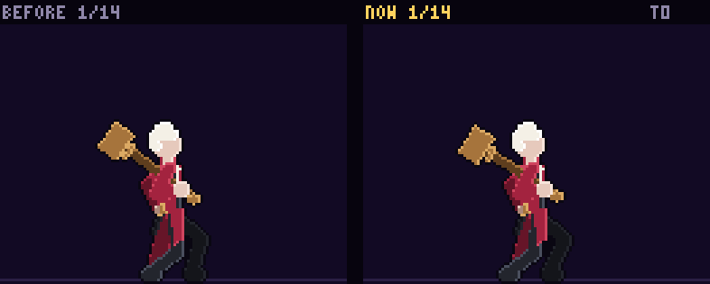

[0.5배속](edward-walk_b-compare-half.gif) · [끝점 경로](edward-walk_b-path.png) · [실루엣 띠](edward-walk_b-sil.png)

- **바꾼 것**: 앞 걷기와 같은 걸음 함수(한 커밋).
- **일곱 요소**: 해당 없음 — 공격이 아님
- **프레임 수**: 14장 그대로.

### 21. 점프 `edward/jump` — 12 → 12프레임 (24틱), B (2차) → A

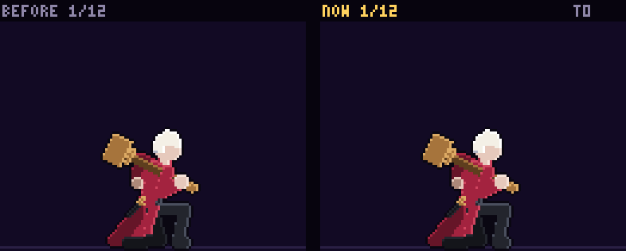

[0.5배속](edward-jump-compare-half.gif) · [끝점 경로](edward-jump-path.png) · [실루엣 띠](edward-jump-sil.png)

- **바꾼 것**: 어깨 위 해머가 몸보다 늦게: 박차고 솟는 동안 머리가 어깨에 눌려 처졌다가, 꼭대기에서 몸이 멈추면 한 번 더 떠올랐다 내려앉는다. 몸 자세·박자 그대로.
- **일곱 요소**: 해당 없음 — 공격이 아님
- **프레임 수**: 12장 그대로(점프 준비·솟음 프레임 번호는 sim 규칙).

### 22. 낙하 `edward/fall` — 12 → 6프레임 (36틱), B (간격·2차) → A

[0.5배속](edward-fall-compare-half.gif) · [끝점 경로](edward-fall-path.png) · [실루엣 띠](edward-fall-sil.png)

- **바꾼 것**: 꼭대기 웅크림 → 무릎이 풀림 → 한 번에 다리를 넓게 펴고(해머 머리가 늦게 떠오름) → 팔로 균형 → 착지 준비(해머가 늦게 내려앉음) → 빨리 떨어지면 무릎을 더 굽힘.
- **일곱 요소**: 해당 없음 — 공격이 아님
- **프레임 수**: 6장. 떨어지는 빠르기로 프레임을 고르는 동작이라 dur 합 36 그대로, 착지 첫 자세 그대로.

### 23. 착지 `edward/land` — 12 → 8프레임 (12틱), B (모두 1틱·2차) → A

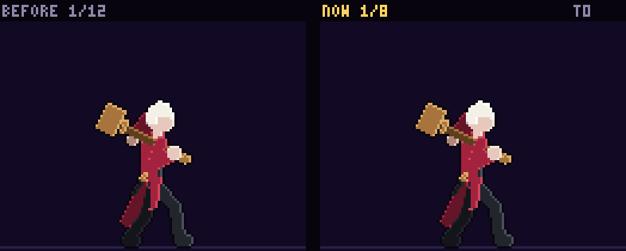

[0.5배속](edward-land-compare-half.gif) · [끝점 경로](edward-land-path.png) · [실루엣 띠](edward-land-sil.png)

- **바꾼 것**: 발이 닿음 → 무릎이 꺾임 → 쿵 깊게 받음 → 해머 머리가 늦게 어깨를 눌러 2px 더 → 밀어 일어남 → 일어섬 → 자리 잡음(해머가 늦게 튐) → 기본자세.
- **일곱 요소**: 해당 없음 — 공격이 아님
- **프레임 수**: 8장(착지 길이를 프레임 수로 고르게 나누는 동작).

### 24. 공중 대시 `edward/air_dash` — 12 → 8프레임 (12틱), B (모두 1틱·2차) → A

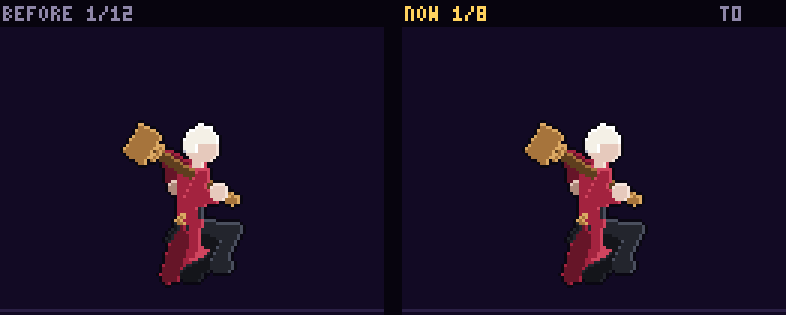

[0.5배속](edward-air_dash-compare-half.gif) · [끝점 경로](edward-air_dash-path.png) · [실루엣 띠](edward-air_dash-sil.png)

- **바꾼 것**: 꼭대기 → 웅크려 두 손으로 해머를 어깨 뒤로 당김 → 몸을 던짐(다리가 끌리고 해머 머리는 뒤에 처짐) → 해머가 따라잡음 → 미끄러지며 더 눕고 머리가 한 번 더 쏠림 → 몸을 세움(뒷손이 놓고 해머는 늦게 넘어옴) → 낙하 준비. 같은 돌진 자세 6장 대신 프레임마다 다른 자세.
- **일곱 요소**: 해당 없음 — 공격이 아님
- **프레임 수**: 8장(12틱을 프레임 수로 고르게 나누는 동작).

### 25. 방어 막힘 `edward/guard_hit` — 12 → 7프레임 (12틱), B (복사·모두 1틱·2차) → A

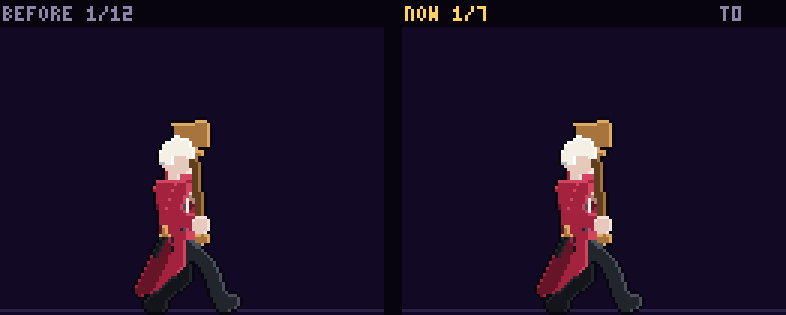

[0.5배속](edward-guard_hit-compare-half.gif) · [끝점 경로](edward-guard_hit-path.png) · [실루엣 띠](edward-guard_hit-sil.png)

- **바꾼 것**: 손잡이째 밀려 젖혀짐 → 한 번 더 밀려 내려앉음(해머 머리는 늦게 젖혀짐) → 무릎으로 받아 가장 낮게 → 숙여 밈(머리는 아직 뒤) → 해머 머리가 늦게 앞으로 넘어감(지나치기) → 되세움 → 막기.
- **일곱 요소**: 해당 없음 — 공격이 아님
- **프레임 수**: 7장(막힌 경직 길이를 프레임 수로 고르게 나누는 동작).

### 26. 등장 `edward/intro` — 14 → 14프레임 (80틱), B (복사) → A

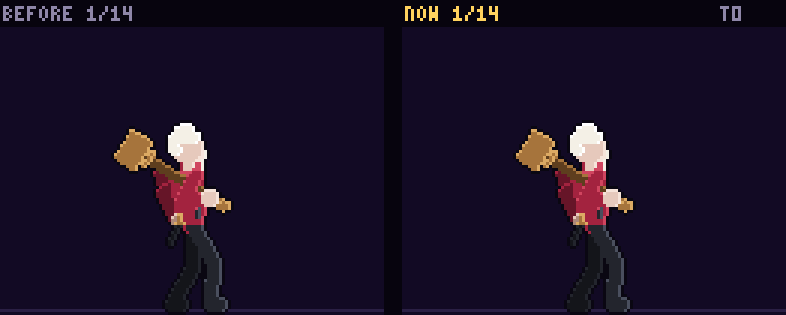

[0.5배속](edward-intro-compare-half.gif) · [끝점 경로](edward-intro-path.png) · [실루엣 띠](edward-intro-sil.png)

- **바꾼 것**: 착지 뒤 "선다" 자세를 두 장 늘어놓던 5번을 바꿈: 선다(해머 머리는 착지에 눌렸다가 늦게 떠오름) → 껍데기가 비치는 동안 가슴을 더 펴고 턱을 들며 해머가 어깨에 늦게 자리 잡음.
- **일곱 요소**: 해당 없음 — 공격이 아님
- **프레임 수**: 14장 그대로. 떨어짐 20틱·착지·장막 24틱 박자 그대로.

### 27. 승리 `edward/win` — 14 → 8프레임 (51틱), B (복사·2차) → A

[0.5배속](edward-win-compare-half.gif) · [끝점 경로](edward-win-path.png) · [실루엣 띠](edward-win-sil.png)

- **바꾼 것**: 손이 먼저 해머를 어깨에서 들어 배 앞으로(머리는 처짐) → 머리가 늦게 앞으로 넘어와 → 바닥에 쿵 세우며 내려앉음 → 손잡이가 무게에 앞으로 한 번 기울었다 돌아옴 → 손잡이 끝에 두 손을 포갬 → 가슴을 펴고 → 턱을 든다(끝 자세에 머문다).
- **일곱 요소**: 해당 없음 — 공격이 아님
- **프레임 수**: 8장. 끝의 같은 자세 복사를 dur로 머물게.

### 28. 벽 붙기 `edward/wall_cling` — 13 → 9프레임 (36틱), B (복사) → A

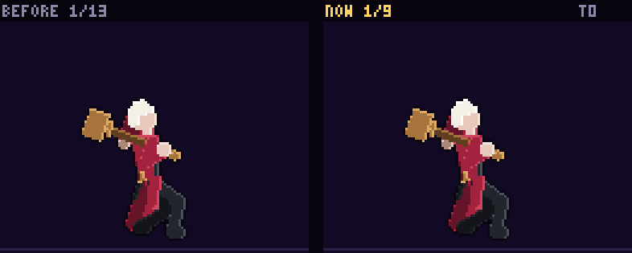

[0.5배속](edward-wall_cling-compare-half.gif) · [끝점 경로](edward-wall_cling-path.png) · [실루엣 띠](edward-wall_cling-sil.png)

- **바꾼 것**: 쿵 부딪혀 몸이 접히고(해머 머리는 늦게 어깨에 눌림) 웅크려 붙음(한 번) → 미끄러지는 동안 되풀이: 미끄러지기 시작 → 긁으며 내려감 → 더 내려감 → 탁 다시 짚음 → 자리 잡음(해머가 늦게 튐).
- **일곱 요소**: 해당 없음 — 공격이 아님
- **프레임 수**: 9장. 키 사이를 고르게 채우던 되풀이 9장을 바뀌는 자세 5장으로. 되풀이 시작 프레임은 모든 캐릭터 공통 그대로.

### 29. 벽 점프 `edward/wall_jump` — 14 → 14프레임 (26틱), B (2차) → A

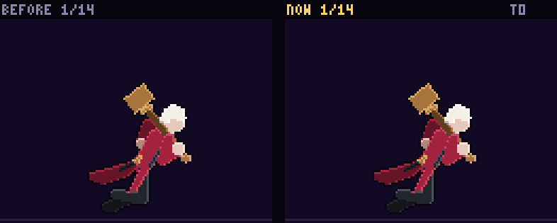

[0.5배속](edward-wall_jump-compare-half.gif) · [끝점 경로](edward-wall_jump-path.png) · [실루엣 띠](edward-wall_jump-sil.png)

- **바꾼 것**: 박차는 힘에 몸이 먼저 튀어 나가고(해머는 어깨 위에 누운 채) → 솟는 동안 해머 머리가 뒤로 끌렸다가 → 무릎을 당길 때 앞으로 지나치고 → 낙하 자세에서 자리 잡는다.
- **일곱 요소**: 해당 없음 — 공격이 아님
- **프레임 수**: 14장 그대로.

### 30. 벽 달리기 `edward/wall_run` — 14 → 14프레임 (39틱), B (간격·2차) → B (간격)

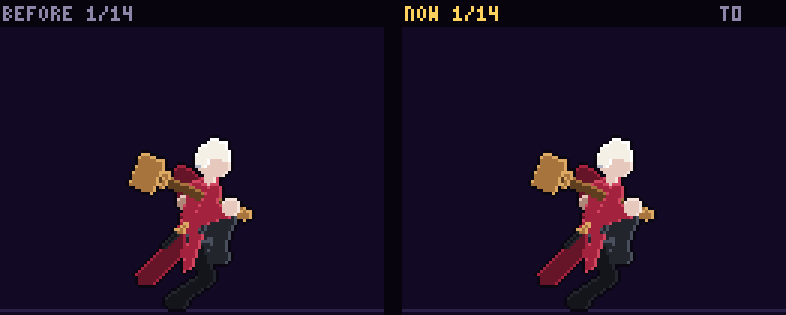

[0.5배속](edward-wall_run-compare-half.gif) · [끝점 경로](edward-wall_run-path.png) · [실루엣 띠](edward-wall_run-sil.png)

- **바꾼 것**: 발을 바꿔 딛는 사이 프레임에서 몸이 먼저 올라가고 해머 머리는 아래로 처졌다가 딛고 버틸 때 늦게 들썩인다. 모서리를 잡고 한 번에 끌어올리는 프레임을 더함(해머 머리는 늦게 끌려 처졌다 튀어 오름).
- **일곱 요소**: 해당 없음 — 공격이 아님
- **프레임 수**: 14장 그대로. 남은 간격 신호는 아래 "고치지 않고 둔 B".

### 31. 벽 낙법 `edward/wall_tech` — 13 → 13프레임 (28틱), B (2차) → A

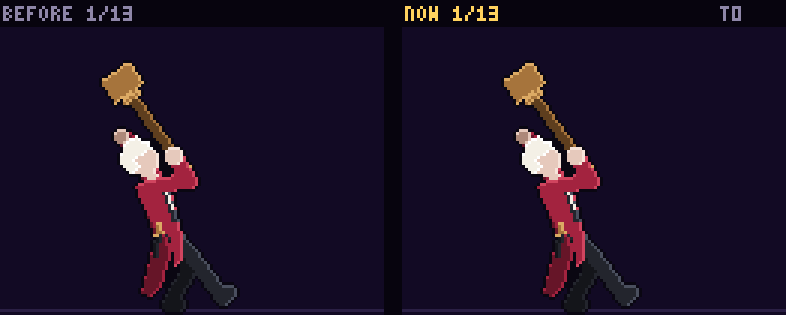

[0.5배속](edward-wall_tech-compare-half.gif) · [끝점 경로](edward-wall_tech-path.png) · [실루엣 띠](edward-wall_tech-sil.png)

- **바꾼 것**: 해머가 몸과 똑같이 돌던 것을 몸보다 늦게: 무릎을 끌어당길 때 머리가 늦게 따라와 박찰 때 등 뒤에 눕고, 공중제비 동안 몸이 먼저 돌고 머리가 뒤에 남았다가 따라잡아, 다 돌 무렵 한 번 지나친 뒤 몸을 펴며 자리 잡는다.
- **일곱 요소**: 해당 없음 — 공격이 아님
- **프레임 수**: 13장 그대로.

## 이펙트 확인

게임 화면으로 11장면(지상 1~4타, 쓸기·대시 공격, 띄우기·공중 1~3타, 내려찍기, 차지, 스킬 1, 염동력 끌어당김·밀어냄, 이동, 벽 기동, 방어)을 찍었습니다. 모두 페이지 오류가 없었고, 이펙트가 새 자세를 따라갑니다. 아래는 판정 틱의 화면입니다.

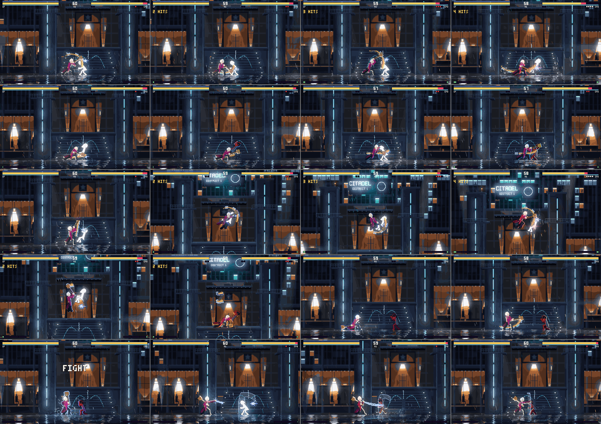

위에서부터 한 줄씩:

1. **지상 1~4타**(`edward_ground`): 청동빛 원호와 해머 머리 잔상이 원호(`EDWARD_ARCS`) 위 그대로 그려지고, 그림의 해머 머리가 그 원호 위에 있습니다(6~9).
2. **쓸기 → 대시 공격**(`edward_low`): 원호가 정해지지 않은 두 기술은 그림 해머 머리가 지난 길을 따라 그립니다. 쓸기는 발목 높이로 낮게, 대시 공격은 허리 앞을 가로지르는 호로 새 자세를 따라갑니다(2·3).
3. **띄우기 → 공중 1·2·3타**(`edward_air`): 띄우기는 수직으로 솟는 새 머리 길을, 공중 1~3타는 원호를 따라갑니다(10·12~14).
4. **내려찍기 · 차지**(`edward_slam`·`edward_charge`): 떨어지는 동안 머리 위 해머, 착지 충격파(15). 차지는 모으는 동안 해머 머리가 바닥을 긁는 홈·불꽃이 새 머리 자리를 따라가고, 떼면 올려치기 원호(11).
5. **스킬 1 · 염동력**(`edward_reenact`·`edward_pull`·`edward_push`): 재현:나의 푸른 오라(17), 끌어당김의 장막 띠가 새 뒷손에서 뻗고(4), 밀어냄의 장막 벽(5).

## 도구

- **`tools/revise.mjs`**: 에드워드 해머 판정 차이를 잽니다. 판정 상자가 해머 머리 궤적을 감싼 상자라, 판정 틱마다 그림 해머 머리(염동력은 뒷손, 내려찍기의 떨어지는 판정은 엉덩이)가 상자 밖으로 나간 거리를 전후로 적습니다.
- **`tools/motioncheck.mjs`**: 염동력 끌어당김(4)의 끝점을 해머 머리가 아니라 장막을 뻗는 뒷손으로 봅니다(`TIP` 표).

## 알아 두실 것

1. **착지·공중 대시·방어 막힘은 dur로 박자를 줄 수 없습니다.** sim과 렌더가 상태 길이를 프레임 수로 고르게 나누는 동작들이라(라이덴·백은우와 같음), 프레임마다 다른 자세를 두어 간격을 만들었습니다. 표시 틱은 뷰어·시트용입니다.
2. **휘두르기의 여운(버티는 길이)은 예전 피격 시간표에 맞췄습니다.** 회복을 앞당기면 예전 피격 상자와 13~17px 어긋나서(3타·공중 1타에서 확인), 버티는 길이를 예전 박자(3타 35틱, 4타 39틱, 공중 1·2타 28틱, 공중 3타 32틱, 내려찍기 35틱)에 맞추고 그 뒤 회복을 더 빠르게 했습니다.
3. **차지의 끝 자세 무기 각도**: 예전에는 −508°(한 바퀴 거꾸로 돌아 어깨로)였는데, 치켜든 해머에서 어깨로 바로 넘어가는 −148°로 바꿨습니다. 그림은 끝에서 같고, 마지막 6틱 동안 해머가 한 바퀴 도는 대신 뒤로 넘어갑니다.
