# 오스카 2차 리워크 (PR 설명 그림판)

오스카 2차 리워크입니다 (`docs/motions/애니메이션재수정지침.md` 2·3·4·5장). 점검표의 **C 등급 8개를 먼저, 그다음 B 등급**을 다시 깎았습니다(월령수류 상대 반응 7개 포함). 보호 목록(걷기, 대시(월영), 벽 기동, 검영 밟기)은 손대지 않았습니다.

**바꾼 것은 그림뿐입니다.** 판정·캔슬·몸 이동(공격 데이터)과 이펙트 코드는 그대로입니다. 아래 확인에서 게임 결과가 한 판도 달라지지 않았고, 그림과 피격 상자의 차이도 모두 8px 안입니다(가장 큰 것 7px).

> 에드워드(#43)가 머지된 뒤 최신 main 위로 옮겨 올렸습니다.
>
> 라이덴(#39)·백은우(#40)·에드워드(#43)의 번호 답도 아직이라 승인목록·보호 목록에 적지 않았습니다. 여기에 같이 답해 주시면 함께 적겠습니다.

**답하는 법**: 번호로 답해 주세요. 예: "3 좋아, 12 '탁' 더 길게". 좋다고 한 것은 `docs/motions/승인목록.md`와 지침 1장 보호 목록에 적겠습니다.

## 한눈에

오스카 40개 가운데 29개와 월령수류 상대 반응 7개, 모두 36개를 다시 깎았습니다. 점검표 등급은 오스카 **A 3 → 32**, **B 32 → 8**, **C 5 → 0**, 상대 반응 7개는 **B 4 · C 3 → A 7**로 바뀌었습니다. 남은 B 8개는 모두 보호 목록입니다.

| 번호 | 동작 | 프레임 (전 → 후) | 총 틱 | 등급 (전 → 후) |
| --- | --- | --- | --- | --- |
| 1 | 방어 | 12 → 5 | 12 | C (복사·눌림·간격) → A |
| 2 | 공중 1타 | 12 → 7 | 20 | C (눌림·간격·감기 없음) → A |
| 3 | 공중 2타 | 12 → 7 | 20 | C (눌림·감기 없음·실루엣) → A |
| 4 | 필살기 장면 2 (검영) | 14 → 5 | 40 | C (복사·눌림·간격) → A |
| 5 | 필살기 장면 5 (어긋남) | 13 → 5 | 40 | C (복사·눌림·간격) → A |
| 6 | 필살기 상대 반응 2 (움츠림) | 14 → 7 | 40 | C (복사·눌림·간격) → A |
| 7 | 필살기 상대 반응 1 짧은 판 | 14 → 7 | 40 | C (복사·눌림·간격) → A |
| 8 | 필살기 상대 반응 6 (무너짐) | 13 → 6 | 30 | C (복사·눌림·간격) → A |
| 9 | 1타 (칼자루에 손) | 13 → 7 | 26 | B (복사·눌림) → A |
| 10 | 2타 (반 걸음 미끄러짐) | 13 → 7 | 26 | B (복사·눌림) → A |
| 11 | 3타 (몸을 살짝 낮춤) | 13 → 7 | 26 | B (복사·눌림) → A |
| 12 | 4타 (반쯤 뽑았다 납도) | 14 → 10 | 30 | B (복사·직선) → A |
| 13 | 띄우기 (위를 올려봄) | 13 → 7 | 27 | B (복사·눌림·간격) → A |
| 14 | 쓸기 (낮게) | 13 → 8 | 27 | B (눌림) → A |
| 15 | 대시 공격 (월영 베기) | 13 → 8 | 26 | B (복사·눌림) → A |
| 16 | 공중 3타 (X자) | 12 → 7 | 20 | B (눌림) → A |
| 17 | 내려찍기 (내려다봄) | 13 → 7 | 26 | B (복사·눌림) → A |
| 18 | 스킬 1 월하참뢰검 | 14 → 16 | 34 | B (복사·눌림·실루엣) → A |
| 19 | 스킬 2 월하윤회궤 | 14 → 17 | 24 | B (복사·눌림·직선) → A |
| 20 | 차지 만검지화 | 14 → 16 | 39 | B (눌림) → A |
| 21 | 필살기 월령수류 발동 | 14 → 16 | 48 | B (복사·눌림·간격·실루엣) → A |
| 22 | 필살기 장면 1 (전개) | 14 → 7 | 70 | B (복사·간격) → A |
| 23 | 필살기 짧은 판 장면 1 (전개·검영) | 14 → 7 | 40 | B (복사·간격) → A |
| 24 | 필살기 장면 3 (정적) | 12 → 5 | 20 | B (복사·간격) → A |
| 25 | 필살기 장면 4 (백색) | 13 → 4 | 20 | B (복사) → A |
| 26 | 필살기 장면 6 (납도) | 13 → 7 | 30 | B (간격) → A |
| 27 | 필살기 상대 반응 1 (굳음) | 14 → 7 | 70 | B (복사·간격) → A |
| 28 | 필살기 상대 반응 3 (정적) | 12 → 3 | 20 | B (복사·눌림) → A |
| 29 | 필살기 상대 반응 4 (베임) | 13 → 9 | 20 | B (간격) → A |
| 30 | 필살기 상대 반응 5 (베여 있음) | 13 → 3 | 40 | B (복사·눌림) → A |
| 31 | 대기 | 14 → 8 | 72 | B (복사·간격) → A |
| 32 | 낙하 | 12 → 6 | 36 | B (복사·간격) → A |
| 33 | 착지 | 12 → 5 | 12 | B (복사·모두 1틱·간격) → A |
| 34 | 공중 대시 | 12 → 6 | 12 | B (복사·모두 1틱) → A |
| 35 | 방어 막힘 | 12 → 5 | 12 | B (복사·모두 1틱) → A |
| 36 | 등장 | 14 → 14 | 112 | B (간격) → A |

## 오스카 몸의 언어 (3장)를 이렇게 옮겼습니다

- **정적과 순간**: 모든 발도가 같은 박자다. "손이 날밑으로 2~3px 물러나며 멈춤(1~3틱) → 칼날이 비치는 1틱(스미어) → '탁' 멈춤 → 여운 → 무게가 뒤로 빠지며 기본자세". 평타 11개가 13~14장에서 7~10장이 됐다(빠른 타격 참고 6~10).
- **움직이기 직전 1~2프레임 완전히 멈춘다**: 칼날이 나오기 직전 프레임은 `stop`으로 멈춘다. 손이 날밑으로 물러나는 2~3px가 감기라서 점검표 "감기 없음"(공중 1·2타)이 풀렸다. 연출 장면도 "긴 정지 → 1틱 예비(움찔) → 1~2틱 순간 → 정지"로 깎았다.
- **칼 동작은 스미어 1프레임**: 칼날이 비치는 프레임은 언제나 1틱 한 장이다(평타 11개, 스킬 1, 차지 떼기, 장면 3·4).
- **납도할 때 칼자루가 닿는 순간 1프레임 정지**: '탁' 프레임은 `stop`. 4타·등장·장면 6은 "천천히 밀어 넣음 → 반쯤 남기고 멈춤 → 1틱 긴장 → 남은 칼날이 한 번에 들어가 '탁'"으로, 느린 납도 끝에 순간을 둔다.
- **굽은 노인 자세를 지키고, 몸 대신 손과 칼자루만**: 몸통 기울기는 대부분 8~18°, 엉덩이 출렁임은 3px 안(쓸기·대시 공격 제외). 그래서 그림과 피격 상자 차이도 1~5px로 작다(공중 대시 7px).
- **작은 몸, 거대한 베기(13장)**: 타격 프레임은 칼자루 손과 드러난 칼날로 읽히고, 대기와 실루엣 겹침은 41~76%다(스킬 1 82% → 75%, 필살기 발동 88% → 67%, 공중 2타 83% → 57%).

## 확인 (5장)

**sim이 바꾸기 전과 같습니다.**
- `npm run simtest`: 모두 통과, 출력(CPU 대전 해시 포함)이 바꾸기 전과 같습니다(걸린 시간 줄만 다름).
- 같은 시드 자동 대전(`npm run hitcompare`, 5캐릭터 모든 짝 · 양쪽 자리 · 시드 4개 = 100판): 결과 JSON이 바꾸기 전과 같습니다.
- 기술 데이터(판정·캔슬·몸 이동·총 틱) 해시가 같습니다.

| 캐릭터 | 맞힘 (전 → 후) | 막힘 (전 → 후) | 크러시 (전 → 후) | 준 피해 합계 (전 → 후) |
| --- | --- | --- | --- | --- |
| 라이덴 | 2526 → 2526 | 902 → 902 | 46 → 46 | 75829 → 75829 |
| 백은우 | 1138 → 1138 | 453 → 453 | 9 → 9 | 72963 → 72963 |
| 에드워드 | 1040 → 1040 | 703 → 703 | 157 → 157 | 57801 → 57801 |
| 오스카 | 1289 → 1289 | 1002 → 1002 | 79 → 79 | 62968 → 62968 |
| 기본 스틱맨 | 1576 → 1576 | 329 → 329 | 6 → 6 | 61735 → 61735 |

**바뀐 그림은 오스카 29개와 월령수류 상대 반응 7개뿐입니다.** 220개 동작의 관절·표시 틱을 바꾸기 전과 하나하나 맞댔습니다. 보호 목록과 다른 캐릭터 동작은 그대로입니다.

**그림과 판정의 차이 (4장)**: 8px 넘게 어긋난 곳은 없습니다.
- 오스카의 판정은 발밑 기준 베기 선(`data/poses/oscar/slashes`)을 sim이 직접 냅니다(관절 판정 예외). 그림 관절과 무관해 그대로입니다.
- 피격 상자의 가장 큰 차이는 7px(공중 대시), 나머지는 0~5px입니다.
- 타격 틱·총 틱·차지 되풀이 경계(10·26틱)·스킬 2 옮김(9틱)·등장 '탁'(100틱, 렌더 반짝 101틱)·필살기 장면 길이(70·40·20·20·40·30틱)는 모두 그대로입니다.

**이펙트가 새 자세를 따라가는지** 게임 화면으로 확인했습니다(`npm run moveclip`). 결과는 아래 "이펙트 확인"에 있습니다.

**네 캐릭터 같은 공격의 타격 프레임** (첫 판정 틱):

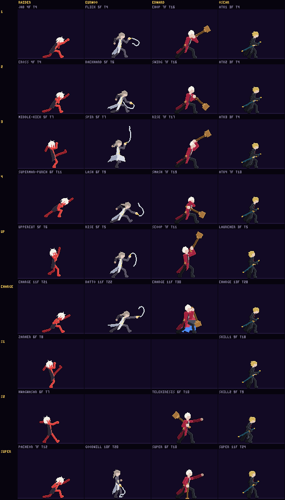

**실루엣 띠**: [silhouette-oscar.png](../motions/silhouette-oscar.png) · [상대 반응 포함 공통](../motions/silhouette-common-base.png) · 점검표 `docs/motions/점검표.md`

## 동작별

보는 법:
- **GIF**: 왼쪽 BEFORE · 오른쪽 NOW, 같은 자리·실제 속도, 판정 상자 없음, 판정 틱에 HIT.
- **일곱 요소**: 점검 도구 값입니다. 오스카는 3장대로 몸 대신 손과 칼자루만 움직여서 ①~④·⑥이 대부분 비고, 그 자리에 발도 박자(감기·칼날·'탁')의 프레임을 적었습니다. ⑤의 겹침은 대기와 단색 실루엣이 겹치는 비율입니다.
- **링크**: 0.5배속 GIF, 끝점 경로(회색 = 전, 노랑 = 지금, 점 옆 숫자 = 프레임), 단색 실루엣 띠(위 = 전, 아래 = 지금, 빨강 = 첫 판정 프레임)입니다.
- 프레임 번호는 1부터 셉니다.

### 1. 방어 `oscar/guard` — 12 → 5프레임 (12틱), C (복사·눌림·간격) → A

[0.5배속](oscar-guard-compare-half.gif) · [끝점 경로](oscar-guard-path.png) · [실루엣 띠](oscar-guard-sil.png)

- **바꾼 것**: 손이 칼집과 날밑을 잡는다(몸은 멈춰 있다) → 한 프레임에 칼이 7px 튀어나오며 등이 펴지고 가장 낮게 내려앉음(스미어 1틱) → 3px 되들어가며 숨을 고름 → 막기 자세. sim은 그대로 마지막 프레임에 머뭅니다.
- **일곱 요소**: 해당 없음 — 공격이 아님
- **프레임 수**: 5장. 키 3개를 12장 × 1틱으로 늘이던 것 대신, 잡음 → 튀어나옴 → 자리 잡음만.

### 2. 공중 1타 `oscar/air1` — 12 → 7프레임 (20틱), C (눌림·간격·감기 없음) → A

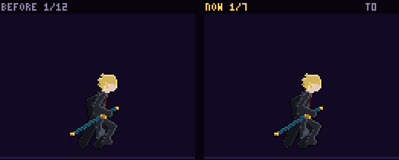

[0.5배속](oscar-air1-compare-half.gif) · [끝점 경로](oscar-air1-path.png) · [실루엣 띠](oscar-air1-sil.png)

- **바꾼 것**: 등을 살짝 젖히고 손이 날밑으로 물러나 멈춤(1틱, 감기) → 칼날이 5px 비치는 1틱(선이 생기는 2틱)에 아래로 긋는 선을 따라 몸이 숙고 뒷다리가 뒤로 뻗음 → '탁' 멈춤 → 고개를 숙인 여운 → 뒷손이 등 뒤로 → 공중 자세.
- **일곱 요소**: ① 2→3(1→7px) · ② – · ③ – · ④ – · (①~④: 오스카는 몸 대신 손과 칼자루만 움직인다 (3장). 감기 = 2번 등을 젖히며 손이 날밑으로 2px, 앞으로 = 3번 칼날 5px 1틱) · ⑤ 3 (칼날이 비친 칼자루 손, 대기와 실루엣 겹침 57%. 몸 대신 앞 허공의 베기 선이 길게 뻗는다) · ⑥ – (의도: 4번 '탁'에 칼자루가 칼집에 닿고 베기 선이 대신 뻗는다, 13-0) · ⑦ 6~7
- **프레임 수**: 7장. 빠른 타격 참고 6~10. 판정 2틱 그대로.

### 3. 공중 2타 `oscar/air2` — 12 → 7프레임 (20틱), C (눌림·감기 없음·실루엣) → A

[0.5배속](oscar-air2-compare-half.gif) · [끝점 경로](oscar-air2-path.png) · [실루엣 띠](oscar-air2-sil.png)

- **바꾼 것**: 무릎을 당겨 웅크리고 고개를 숙여 멈춤(1틱, 감기) → 칼날이 비치는 1틱에 올려 긋는 선을 따라 몸이 위로 펴지며 고개가 들리고 앞다리가 뻗음 → '탁' 멈춤 → 여운 → 공중 자세. 첫 프레임과 실루엣 겹침 83% → 57%.
- **일곱 요소**: ① – · ② – · ③ – · ④ – · (①~④: 오스카는 몸 대신 손과 칼자루만 움직인다 (3장). 감기 = 2번 웅크리며 손이 날밑으로 2px, 앞으로 = 3번 칼날 5px 1틱에 몸이 위로 펴짐) · ⑤ 3 (칼날이 비친 칼자루 손, 대기와 실루엣 겹침 57%. 몸 대신 앞 허공의 베기 선이 길게 뻗는다) · ⑥ – (의도: 4번 '탁'에 칼자루가 칼집에 닿고 베기 선이 대신 뻗는다, 13-0) · ⑦ 6~7
- **프레임 수**: 7장. 공중 1타와 같은 박자.

### 4. 필살기 장면 2 (검영) `oscar/super_orbit` — 14 → 5프레임 (40틱), C (복사·눌림·간격) → A

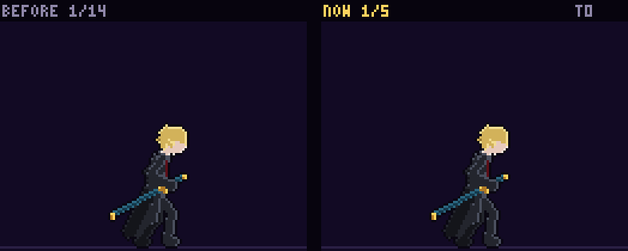

[0.5배속](oscar-super_orbit-compare-half.gif) · [끝점 경로](oscar-super_orbit-path.png) · [실루엣 띠](oscar-super_orbit-sil.png)

- **바꾼 것**: 눈을 감고 멈춤 → 숨 한 번(1px) → 고개가 한 번 더 숙었다가(1틱, 감기) → 한 번에 고개를 듦(2틱, 순간) → 든 채 멈춤.
- **일곱 요소**: 해당 없음 — 공격이 아님
- **프레임 수**: 5장. 키 3개를 14장으로 늘이던 것 대신. 정적과 순간.

### 5. 필살기 장면 5 (어긋남) `oscar/super_cut` — 13 → 5프레임 (40틱), C (복사·눌림·간격) → A

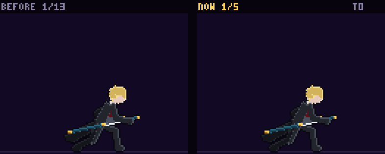

[0.5배속](oscar-super_cut-compare-half.gif) · [끝점 경로](oscar-super_cut-path.png) · [실루엣 띠](oscar-super_cut-sil.png)

- **바꾼 것**: 등을 돌린 채 칼을 든 그대로 멈춤 → 숨을 내쉬며 어깨가 내려앉음 → 고개가 한 번 더 숙었다가(1틱) → 한 번에 몸을 세우며 고개를 듦(2틱) → 칼을 거두어 납도를 시작하는 자세로 멈춤(장면 6 첫 자세).
- **일곱 요소**: 해당 없음 — 공격이 아님
- **프레임 수**: 5장. 키 3개를 13장으로 늘이던 것 대신.

### 6. 필살기 상대 반응 2 (움츠림) `react/oscar_orbit` — 14 → 7프레임 (40틱), C (복사·눌림·간격) → A

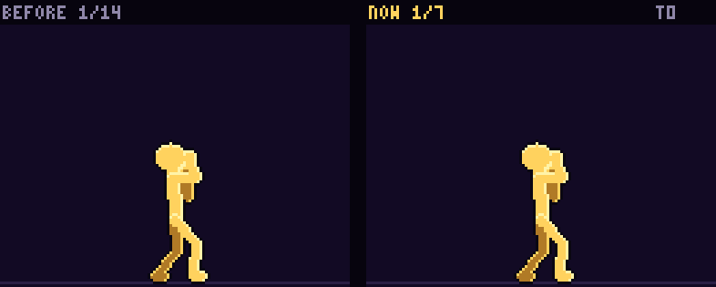

[0.5배속](react-oscar_orbit-compare-half.gif) · [끝점 경로](react-oscar_orbit-path.png) · [실루엣 띠](react-oscar_orbit-sil.png)

- **바꾼 것**: 달을 올려다본 채 굳음 → 검영이 지나며 고개가 움찔(1틱) → 어깨를 움츠리며 팔이 올라감(2틱) → 굳음 → 등 뒤로 도는 검영에 고개가 숙여졌다가(1틱) → 한 번 더 움츠리며 고개를 듦 → 버팀(다음 장면 첫 자세).
- **일곱 요소**: 해당 없음 — 공격이 아님
- **프레임 수**: 7장. 키 3개를 14장으로 늘이던 것 대신, 움찔할 때만 프레임.

### 7. 필살기 상대 반응 1 짧은 판 `react/oscar_open_s` — 14 → 7프레임 (40틱), C (복사·눌림·간격) → A

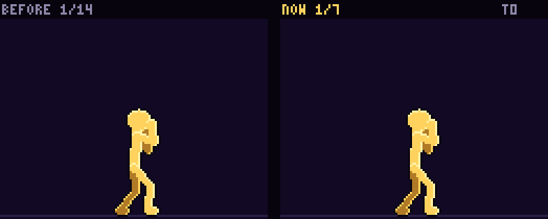

[0.5배속](react-oscar_open_s-compare-half.gif) · [끝점 경로](react-oscar_open_s-path.png) · [실루엣 띠](react-oscar_open_s-sil.png)

- **바꾼 것**: 서 있음 → 고개가 움찔 숙었다가(1틱) → 바뀌는 하늘을 홱 올려다봄(2틱, 지나쳤다 돌아옴) → 굳음 → 고개가 내려오기 시작하다(1틱) → 둘레의 검영에 움츠림(2틱) → 버팀.
- **일곱 요소**: 해당 없음 — 공격이 아님
- **프레임 수**: 7장. 키 3개를 14장으로 늘이던 것 대신.

### 8. 필살기 상대 반응 6 (무너짐) `react/oscar_fall` — 13 → 6프레임 (30틱), C (복사·눌림·간격) → A

[0.5배속](react-oscar_fall-compare-half.gif) · [끝점 경로](react-oscar_fall-path.png) · [실루엣 띠](react-oscar_fall-sil.png)

- **바꾼 것**: 팔을 늘어뜨린 채 섬 → 몸이 한 번 흔들림 → '탁' 직전 굳음(1틱) → '탁'(26틱)에 고개가 뒤로 꺾이며 팔이 튐 → 무릎이 꺾임 → 무너짐. 끝 자세는 예전 그대로(쓰러짐으로 이어진다).
- **일곱 요소**: 해당 없음 — 공격이 아님
- **프레임 수**: 6장. 키 3개를 13장으로 늘이던 것 대신. '탁' 틱은 장면 6과 같은 26틱.

### 9. 1타 (칼자루에 손) `oscar/atk1` — 13 → 7프레임 (26틱), B (복사·눌림) → A

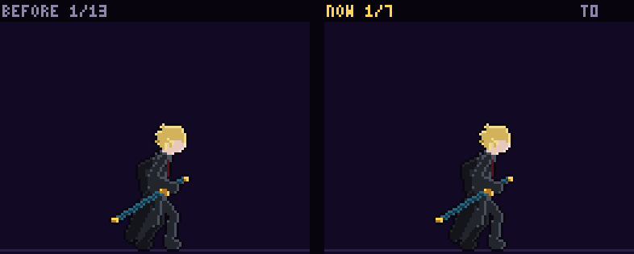

[0.5배속](oscar-atk1-compare-half.gif) · [끝점 경로](oscar-atk1-path.png) · [실루엣 띠](oscar-atk1-sil.png)

- **바꾼 것**: 기본자세 → 손이 날밑으로 2px 물러나며 고개를 숙여 멈춤(감기·직전 정지) → 칼날 5px 1틱(스미어, 4틱째 선) → '탁' 멈춤 → 고개를 숙인 여운 → 무게가 뒤로 빠짐 → 기본자세.
- **일곱 요소**: ① – · ② – · ③ – · ④ – · (①~④: 오스카는 몸 대신 손과 칼자루만 움직인다 (3장). 감기 = 2번 손이 날밑으로 2px, 앞으로 = 3번 칼날 5px 1틱) · ⑤ 3 (칼날이 비친 칼자루 손, 대기와 실루엣 겹침 76%. 몸 대신 앞 허공의 베기 선이 길게 뻗는다) · ⑥ – (의도: 4번 '탁'에 칼자루가 칼집에 닿고 베기 선이 대신 뻗는다, 13-0) · ⑦ 6~7
- **프레임 수**: 7장. 빠른 타격 참고 6~10. 손을 얹는 같은 자세 2장·'탁' 2장·사이 프레임을 늘어놓던 13장 대신.

### 10. 2타 (반 걸음 미끄러짐) `oscar/atk2` — 13 → 7프레임 (26틱), B (복사·눌림) → A

[0.5배속](oscar-atk2-compare-half.gif) · [끝점 경로](oscar-atk2-path.png) · [실루엣 띠](oscar-atk2-sil.png)

- **바꾼 것**: 기본자세 → 무게를 뒷발에 싣고 손이 날밑으로 물러나 멈춤 → 칼날 5px 1틱에 앞발이 반 걸음 미끄러짐(선) → '탁' 멈춤 → 뒷발이 끌려오는 여운 → 무게가 뒤로 → 기본자세.
- **일곱 요소**: ① – · ② – · ③ – · ④ – · (①~④: 오스카는 몸 대신 손과 칼자루만 움직인다 (3장). 감기 = 2번 무게를 뒷발에, 손이 날밑으로, 앞으로 = 3번 칼날 5px 1틱에 앞발이 미끄러짐) · ⑤ 3 (칼날이 비친 칼자루 손, 대기와 실루엣 겹침 69%. 몸 대신 앞 허공의 베기 선이 길게 뻗는다) · ⑥ – (의도: 4번 '탁'에 칼자루가 칼집에 닿고 베기 선이 대신 뻗는다, 13-0) · ⑦ 6~7
- **프레임 수**: 7장.

### 11. 3타 (몸을 살짝 낮춤) `oscar/atk3` — 13 → 7프레임 (26틱), B (복사·눌림) → A

[0.5배속](oscar-atk3-compare-half.gif) · [끝점 경로](oscar-atk3-path.png) · [실루엣 띠](oscar-atk3-sil.png)

- **바꾼 것**: 무릎을 굽혀 낮추고 손이 날밑으로 물러나 멈춤 → 칼날 5px 1틱에 1px 더 가라앉음(가로 선 두 줄) → '탁' 멈춤 → 낮은 채 여운 → 일어나며 무게가 뒤로 → 기본자세.
- **일곱 요소**: ① – · ② – · ③ – · ④ – · (①~④: 오스카는 몸 대신 손과 칼자루만 움직인다 (3장). 감기 = 2번 낮추며 손이 날밑으로, 앞으로 = 3번 칼날 5px 1틱) · ⑤ 3 (칼날이 비친 칼자루 손, 대기와 실루엣 겹침 65%. 몸 대신 앞 허공의 베기 선이 길게 뻗는다) · ⑥ – (의도: 4번 '탁'에 칼자루가 칼집에 닿고 베기 선이 대신 뻗는다, 13-0) · ⑦ 6~7
- **프레임 수**: 7장.

### 12. 4타 (반쯤 뽑았다 납도) `oscar/atk4` — 14 → 10프레임 (30틱), B (복사·직선) → A

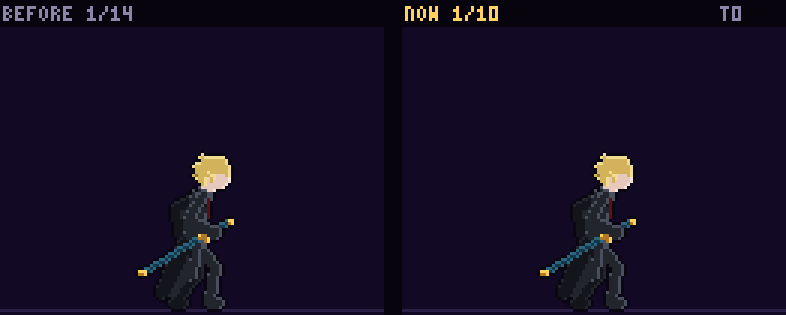

[0.5배속](oscar-atk4-compare-half.gif) · [끝점 경로](oscar-atk4-path.png) · [실루엣 띠](oscar-atk4-sil.png)

- **바꾼 것**: 손이 날밑으로, 멈춤 → 1틱에 칼을 8px 뽑음(스미어) → 칼날을 내려다보며 멈춤(직전 정지) → 몸을 숙이며 밀어 넣음(손이 호를 그린다, 직선 궤적 풀림) → '탁'(10틱, 선 세 줄) 멈춤 → 고개를 깊이 숙인 여운 → 무게가 뒤로 → 기본자세.
- **일곱 요소**: ① – · ② – · ③ – · ④ – · (①~④: 오스카는 몸 대신 손과 칼자루만 움직인다 (3장). 감기 = 3번 칼을 8px 뽑음(납도 반대쪽), 앞으로 = 5~6번 몸을 숙이며 밀어 넣음) · ⑤ 7 (칼날이 비친 칼자루 손, 대기와 실루엣 겹침 74%. 몸 대신 앞 허공의 베기 선이 길게 뻗는다) · ⑥ – (의도: 7번 '탁'에 칼자루가 칼집에 닿고 베기 선이 대신 뻗는다, 13-0) · ⑦ 9~10
- **프레임 수**: 10장. 일반 평타 참고 10~16. 반쯤 뽑은 같은 자세를 사이 프레임으로 늘이던 것 대신.

### 13. 띄우기 (위를 올려봄) `oscar/launcher` — 13 → 7프레임 (27틱), B (복사·눌림·간격) → A

[0.5배속](oscar-launcher-compare-half.gif) · [끝점 경로](oscar-launcher-path.png) · [실루엣 띠](oscar-launcher-sil.png)

- **바꾼 것**: 고개를 더 깊이 숙이고 손이 날밑으로 물러나 멈춤(감기) → 칼날 4px 1틱에 고개를 홱 들어 위를 봄(세로 선) → '탁' 멈춤 → 올려다본 채 여운 → 고개가 내려옴 → 기본자세.
- **일곱 요소**: ① – · ② – · ③ – · ④ – · (①~④: 오스카는 몸 대신 손과 칼자루만 움직인다 (3장). 감기 = 2번 고개를 더 숙이며 손이 날밑으로, 앞으로 = 3번 칼날 4px 1틱에 고개를 듦) · ⑤ 3 (칼날이 비친 칼자루 손, 대기와 실루엣 겹침 70%. 몸 대신 앞 허공의 베기 선이 길게 뻗는다) · ⑥ – (의도: 4번 '탁'에 칼자루가 칼집에 닿고 베기 선이 대신 뻗는다, 13-0) · ⑦ 6~7
- **프레임 수**: 7장. 판정 5틱 그대로.

### 14. 쓸기 (낮게) `oscar/sweep` — 13 → 8프레임 (27틱), B (눌림) → A

[0.5배속](oscar-sweep-compare-half.gif) · [끝점 경로](oscar-sweep-path.png) · [실루엣 띠](oscar-sweep-sil.png)

- **바꾼 것**: 웅크려 내려감 → 낮게 손이 날밑으로 물러나 멈춤 → 칼날 5px 1틱에 한 번 더 가라앉음(바닥에 붙은 가로 선) → '탁' 멈춤 → 낮은 채 여운 → 일어남 → 기본자세.
- **일곱 요소**: ① – · ② – · ③ – · ④ – · (①~④: 오스카는 몸 대신 손과 칼자루만 움직인다 (3장). 감기 = 2~3번 웅크리며 손이 날밑으로, 앞으로 = 4번 칼날 5px 1틱) · ⑤ 4 (칼날이 비친 칼자루 손, 대기와 실루엣 겹침 40%. 몸 대신 앞 허공의 베기 선이 길게 뻗는다) · ⑥ – (의도: 5번 '탁'에 칼자루가 칼집에 닿고 베기 선이 대신 뻗는다, 13-0) · ⑦ 7~8
- **프레임 수**: 8장. 웅크려 내려가는 한 장을 더 둔다.

### 15. 대시 공격 (월영 베기) `oscar/dash_attack` — 13 → 8프레임 (26틱), B (복사·눌림) → A

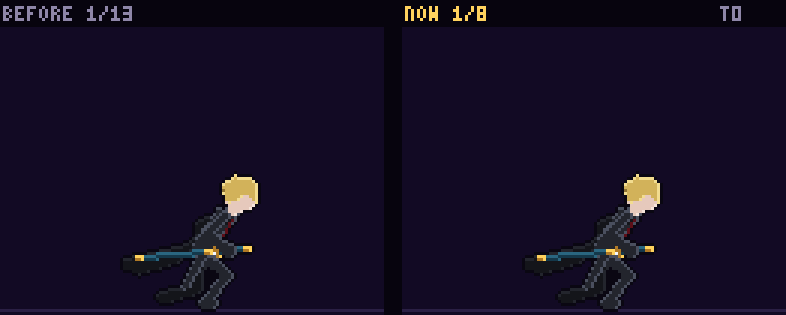

[0.5배속](oscar-dash_attack-compare-half.gif) · [끝점 경로](oscar-dash_attack-path.png) · [실루엣 띠](oscar-dash_attack-sil.png)

- **바꾼 것**: 미끄러짐 → 앞발을 디뎌 멈추기 시작(1틱) → 손이 날밑으로, 멈춤 → 칼날 6px 1틱(선) → '탁' 멈춤 → 숙인 채 여운 → 몸을 세우며 무게가 뒤로 → 기본자세.
- **일곱 요소**: ① – · ② – · ③ – · ④ – · (①~④: 오스카는 몸 대신 손과 칼자루만 움직인다 (3장). 감기 = 2~3번 앞발을 디디며 손이 날밑으로, 앞으로 = 4번 칼날 6px 1틱) · ⑤ 4 (칼날이 비친 칼자루 손, 대기와 실루엣 겹침 42%. 몸 대신 앞 허공의 베기 선이 길게 뻗는다) · ⑥ – (의도: 5번 '탁'에 칼자루가 칼집에 닿고 베기 선이 대신 뻗는다, 13-0) · ⑦ 7~8
- **프레임 수**: 8장. 미끄러짐을 같은 자세 3장으로 늘이던 것 대신.

### 16. 공중 3타 (X자) `oscar/air3` — 12 → 7프레임 (20틱), B (눌림) → A

[0.5배속](oscar-air3-compare-half.gif) · [끝점 경로](oscar-air3-path.png) · [실루엣 띠](oscar-air3-sil.png)

- **바꾼 것**: 고개를 숙이며 반대로 감아 멈춤(1틱) → 칼날 6px 1틱에 크게 비틀어 펴짐(X자 두 줄) → '탁' 멈춤 → 여운 → 공중 자세.
- **일곱 요소**: ① 2→3(0→8px) · ② – · ③ – · ④ – · (①~④: 오스카는 몸 대신 손과 칼자루만 움직인다 (3장). 감기 = 2번 반대로 감으며 손이 날밑으로, 앞으로 = 3번 칼날 6px 1틱에 비틀어 펴짐) · ⑤ 3 (칼날이 비친 칼자루 손, 대기와 실루엣 겹침 54%. 몸 대신 앞 허공의 베기 선이 길게 뻗는다) · ⑥ – (의도: 4번 '탁'에 칼자루가 칼집에 닿고 베기 선이 대신 뻗는다, 13-0) · ⑦ 6~7
- **프레임 수**: 7장.

### 17. 내려찍기 (내려다봄) `oscar/slam` — 13 → 7프레임 (26틱), B (복사·눌림) → A

[0.5배속](oscar-slam-compare-half.gif) · [끝점 경로](oscar-slam-path.png) · [실루엣 띠](oscar-slam-sil.png)

- **바꾼 것**: 공중 자세 → 발밑을 내려다보며 손이 날밑으로 3px 물러나 멈춤(감기·직전 정지) → 칼날 5px 1틱에 몸이 더 숙어 내려다봄(세로 선) → '탁' 멈춤 → 여운 → 고개를 듦 → 공중 자세.
- **일곱 요소**: ① 2→3(4→8px) · ② – · ③ – · ④ – · (①~④: 오스카는 몸 대신 손과 칼자루만 움직인다 (3장). 감기 = 2번 내려다보며 손이 날밑으로 3px, 앞으로 = 3번 칼날 5px 1틱) · ⑤ 3 (칼날이 비친 칼자루 손, 대기와 실루엣 겹침 46%. 몸 대신 앞 허공의 베기 선이 길게 뻗는다) · ⑥ – (의도: 4번 '탁'에 칼자루가 칼집에 닿고 베기 선이 대신 뻗는다, 13-0) · ⑦ 6~7
- **프레임 수**: 7장.

### 18. 스킬 1 월하참뢰검 `oscar/skill1` — 14 → 16프레임 (34틱), B (복사·눌림·실루엣) → A

[0.5배속](oscar-skill1-compare-half.gif) · [끝점 경로](oscar-skill1-path.png) · [실루엣 띠](oscar-skill1-sil.png)

- **바꾼 것**: 표식이 뜨는 18틱 동안 한 동작씩: 상대를 바라봄 → 굳음 → 눈을 가늘게 → 뒷손이 칼집 입구로 → 엄지가 날밑으로(멈춤) → 숨을 들이쉬고 멈춤 → 칼날 5px 1틱(18틱, 원격 베기) → '탁' 멈춤 → 바라본 채 여운 → 고개를 숙임 → 깊이 숙여 멈춤 → 뒷손이 등 뒤로 → 무게가 뒤로 → 기본자세. 대기와 실루엣 겹침 82% → 75%.
- **일곱 요소**: ① – · ② – · ③ – · ④ – · (①~④: 오스카는 몸 대신 손과 칼자루만 움직인다 (3장). 감기 = 6번 엄지가 날밑으로 2px, 8번 숨을 멈춤, 앞으로 = 9번 칼날 5px 1틱) · ⑤ 9 (칼날이 비친 칼자루 손, 대기와 실루엣 겹침 75%. 몸 대신 앞 허공의 베기 선이 길게 뻗는다) · ⑥ – (의도: 10번 '탁'에 칼자루가 칼집에 닿고 베기 선이 대신 뻗는다, 13-0) · ⑦ 12~16
- **프레임 수**: 16장. 스킬 참고 16~30. 같은 자세를 늘어놓던 14장 대신, 표식을 기다리는 동안 한 동작씩.

### 19. 스킬 2 월하윤회궤 `oscar/skill2` — 14 → 17프레임 (24틱), B (복사·눌림·직선) → A

[0.5배속](oscar-skill2-compare-half.gif) · [끝점 경로](oscar-skill2-path.png) · [실루엣 띠](oscar-skill2-sil.png)

- **바꾼 것**: 손이 칼자루로, 고른 검영을 바라보며 멈춤 → 틈으로 두 걸음(발을 들 때 떠오르고 디딜 때 내려앉아 손이 호를 그린다) → 틈 속으로(8틱) → 옮겨 간 틈 속(9틱, 8~10은 렌더가 감춤) → 틈에서 두 걸음 걸어 나옴 → 고개를 듦 → 뒷손이 등 뒤로 → 기본자세.
- **일곱 요소**: 판정 없는 순간이동(9틱 = 9번 프레임). ① – · ② – · ③ – · ④ – · ⑤ 9 (틈 속) · ⑥ – · ⑦ 10~17 (공격이 아니라 걸어 들어가고 나오는 동작)
- **프레임 수**: 17장. 걸음마다 드는 프레임과 딛는 프레임. 9틱 옮김·8~10 감춤 그대로.

### 20. 차지 만검지화 `oscar/charge` — 14 → 16프레임 (39틱), B (눌림) → A

[0.5배속](oscar-charge-compare-half.gif) · [끝점 경로](oscar-charge-path.png) · [실루엣 띠](oscar-charge-sil.png)

- **바꾼 것**: 앞손이 날밑으로 → 뒷손이 칼집 입구로 → 고개를 숙임 → 깊이 숙여 멈춤 → 자리 잡음(10틱) → 모으는 동안 되풀이(10~26틱, 몸은 정지): 내쉼 → 들이쉼 → 엄지가 날밑을 민다 → 내쉼 → 떼면 칼날이 반쯤 나왔다(26틱, 스미어) '탁' 닫힘(27틱) → 깊이 숙인 여운(28틱 꽃이 펼쳐짐) → 고개를 듦 → 무게가 뒤로 → 기본자세.
- **일곱 요소**: ① – · ② – · ③ – · ④ – · (①~④: 오스카는 몸 대신 손과 칼자루만 움직인다 (3장). 감기 = 11번 칼날 7px로 반쯤 뽑음(납도 반대쪽), 앞으로 = 12번 '탁' 닫힘) · ⑤ 13 (칼날이 비친 칼자루 손, 대기와 실루엣 겹침 76%. 몸 대신 앞 허공의 베기 선이 길게 뻗는다) · ⑥ – (의도: 12번 '탁'에 칼자루가 칼집에 닿고 베기 선이 대신 뻗는다, 13-0) · ⑦ 14~16
- **프레임 수**: 16장. 되풀이 경계 10·26틱, 떼기 26틱, 판정 28틱 그대로.

### 21. 필살기 월령수류 발동 `oscar/super` — 14 → 16프레임 (48틱), B (복사·눌림·간격·실루엣) → A

[0.5배속](oscar-super-compare-half.gif) · [끝점 경로](oscar-super-path.png) · [실루엣 띠](oscar-super-sil.png)

- **바꾼 것**: 앞손이 날밑으로 → 눈을 감고 뒷손이 칼집으로 → 들이쉼·멈춤·내쉼 → 고개가 한 번 더 숙었다가(1틱) → 고개를 들고 눈을 뜸 → 앞발을 반 치 내디디며 등을 폄(멈춤) → 엄지가 날밑에서 물러남(1틱, 감기) → 엄지로 날밑을 미는 순간(24틱) 화면 전체 판정 → 숨을 멈춘 채 어깨가 오름 → '탁' → 고개를 숙임 → 무게가 뒤로 빠지며 뒷손이 등 뒤로 → 기본자세. 대기와 실루엣 겹침 88% → 67%.
- **일곱 요소**: ① – · ② – · ③ – · ④ – · (①~④: 오스카는 몸 대신 손과 칼자루만 움직인다 (3장). 감기 = 10번 엄지가 날밑에서 3px 물러남, 앞으로 = 11번 날밑을 밀어 칼날 2px) · ⑤ 11 (칼날이 비친 칼자루 손, 대기와 실루엣 겹침 67%. 몸 대신 앞 허공의 베기 선이 길게 뻗는다) · ⑥ – (의도: 13번 '탁'에 칼자루가 칼집에 닿고 베기 선이 대신 뻗는다, 13-0) · ⑦ 13~16
- **프레임 수**: 16장. 판정 24~28틱 그대로.

### 22. 필살기 장면 1 (전개) `oscar/super_open` — 14 → 7프레임 (70틱), B (복사·간격) → A

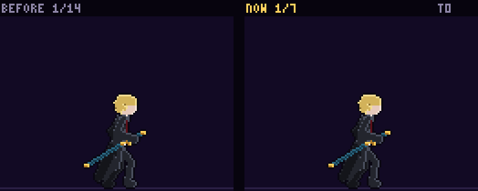

[0.5배속](oscar-super_open-compare-half.gif) · [끝점 경로](oscar-super_open-path.png) · [실루엣 띠](oscar-super_open-sil.png)

- **바꾼 것**: 날밑을 민 자세로 굳음(시간이 멈춤) → 칼날이 되들어가며 고개가 숙음 → 눈을 감고 숨 두 번(들이쉼·내쉼·들이쉼·내쉼).
- **일곱 요소**: 해당 없음 — 공격이 아님
- **프레임 수**: 7장. 사이 프레임 14장 × 5틱 대신 숨마다 한 장.

### 23. 필살기 짧은 판 장면 1 (전개·검영) `oscar/super_open_s` — 14 → 7프레임 (40틱), B (복사·간격) → A

[0.5배속](oscar-super_open_s-compare-half.gif) · [끝점 경로](oscar-super_open_s-path.png) · [실루엣 띠](oscar-super_open_s-sil.png)

- **바꾼 것**: 날밑을 민 자세로 굳음 → 칼날이 되들어가며 고개가 숙음 → 눈을 감고 멈춤 → 숨 한 번 → 고개가 한 번 더 숙었다가(1틱) → 한 번에 고개를 듦(순간) → 든 채 멈춤.
- **일곱 요소**: 해당 없음 — 공격이 아님
- **프레임 수**: 7장.

### 24. 필살기 장면 3 (정적) `oscar/super_still` — 12 → 5프레임 (20틱), B (복사·간격) → A

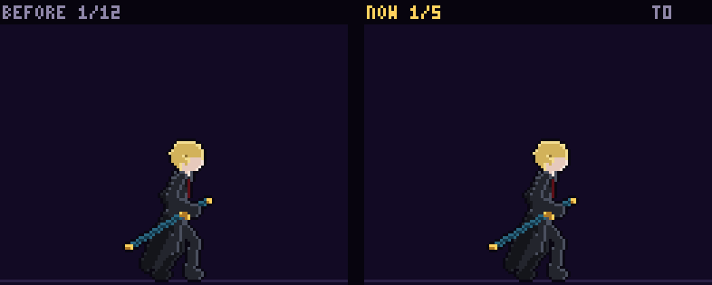

[0.5배속](oscar-super_still-compare-half.gif) · [끝점 경로](oscar-super_still-path.png) · [실루엣 띠](oscar-super_still-sil.png)

- **바꾼 것**: 고개를 든 채 → 엄지가 날밑으로, 완전히 멈춤(5틱) → 엄지가 1px 더 물러남(1틱) → 한 번에 칼을 반 치 넘게 뽑음(1틱, 스미어) → 반 치(7px)에서 멈춤.
- **일곱 요소**: 해당 없음 — 공격이 아님
- **프레임 수**: 5장. 사이 프레임 12장 대신.

### 25. 필살기 장면 4 (백색) `oscar/super_white` — 13 → 4프레임 (20틱), B (복사) → A

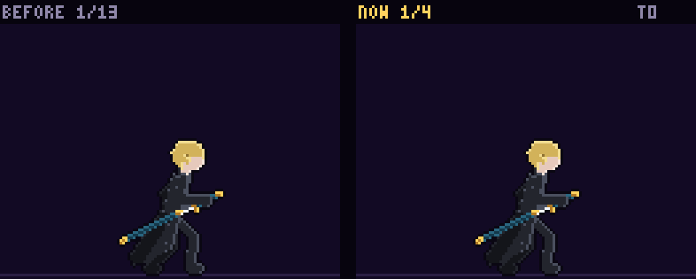

[0.5배속](oscar-super_white-compare-half.gif) · [끝점 경로](oscar-super_white-path.png) · [실루엣 띠](oscar-super_white-sil.png)

- **바꾼 것**: 반 치 뽑은 자세 → 한 번에 다 뽑으며 낮게 상대를 지나침(1틱, 흰 화면 뒤) → 미끄러지며 멈춤 → 등 뒤에 선 자세.
- **일곱 요소**: 해당 없음 — 공격이 아님
- **프레임 수**: 4장. 같은 자세를 사이 프레임으로 늘이던 13장 대신.

### 26. 필살기 장면 6 (납도) `oscar/super_sheathe` — 13 → 7프레임 (30틱), B (간격) → A

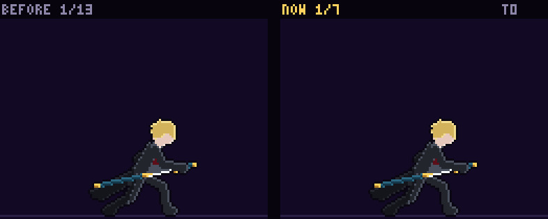

[0.5배속](oscar-super_sheathe-compare-half.gif) · [끝점 경로](oscar-super_sheathe-path.png) · [실루엣 띠](oscar-super_sheathe-sil.png)

- **바꾼 것**: 등을 돌린 채 몸을 세우며 천천히 밀어 넣음(13 → 12 → 10 → 8 → 6px) → 반쯤 남긴 채 멈춤 → 1틱 긴장 → 남은 칼날이 한 번에 미끄러져 들어가 '탁'(26틱).
- **일곱 요소**: 해당 없음 — 공격이 아님
- **프레임 수**: 7장. 고르게 밀어 넣던 13장 대신, 천천히 → 멈춤 → 한 번에.

### 27. 필살기 상대 반응 1 (굳음) `react/oscar_open` — 14 → 7프레임 (70틱), B (복사·간격) → A

[0.5배속](react-oscar_open-compare-half.gif) · [끝점 경로](react-oscar_open-path.png) · [실루엣 띠](react-oscar_open-sil.png)

- **바꾼 것**: 서 있음(시간이 멈춤) → 움찔 숙었다가(1틱) → 고개를 듦 → 바뀌는 하늘을 바라보며 굳음 → 고개가 반쯤 내려왔다(1틱) → 떠오르는 달을 홱 올려다봄(지나쳤다 돌아옴) → 올려다본 채 굳음.
- **일곱 요소**: 해당 없음 — 공격이 아님
- **프레임 수**: 7장.

### 28. 필살기 상대 반응 3 (정적) `react/oscar_still` — 12 → 3프레임 (20틱), B (복사·눌림) → A

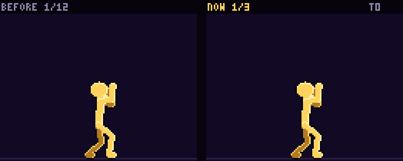

[0.5배속](react-oscar_still-compare-half.gif) · [끝점 경로](react-oscar_still-path.png) · [실루엣 띠](react-oscar_still-sil.png)

- **바꾼 것**: 움츠린 채 → 숨을 멈추고 어깨가 오름 → 굳음.
- **일곱 요소**: 해당 없음 — 공격이 아님
- **프레임 수**: 3장. 키 2개를 12장으로 늘이던 것 대신.

### 29. 필살기 상대 반응 4 (베임) `react/oscar_white` — 13 → 9프레임 (20틱), B (간격) → A

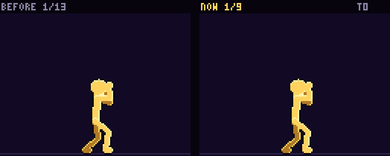

[0.5배속](react-oscar_white-compare-half.gif) · [끝점 경로](react-oscar_white-path.png) · [실루엣 띠](react-oscar_white-sil.png)

- **바꾼 것**: 크게 튀었다가(베기) 잘게 떨리는 것을 네 번 → 팔을 늘어뜨리고 멎음. 튀는 틱과 떨리는 틱의 빠르기가 갈린다.
- **일곱 요소**: 해당 없음 — 공격이 아님
- **프레임 수**: 9장. 고르게 튀던 13장 대신.

### 30. 필살기 상대 반응 5 (베여 있음) `react/oscar_cut` — 13 → 3프레임 (40틱), B (복사·눌림) → A

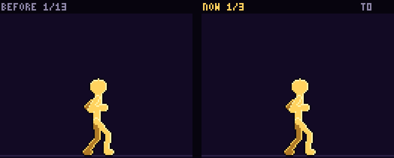

[0.5배속](react-oscar_cut-compare-half.gif) · [끝점 경로](react-oscar_cut-path.png) · [실루엣 띠](react-oscar_cut-sil.png)

- **바꾼 것**: 팔을 늘어뜨린 채 그대로 섬 → 고개가 떨어짐 → 몸이 반쯤 돌아옴(다음 장면 첫 자세).
- **일곱 요소**: 해당 없음 — 공격이 아님
- **프레임 수**: 3장. 키 2개를 13장으로 늘이던 것 대신.

### 31. 대기 `oscar/idle` — 14 → 8프레임 (72틱), B (복사·간격) → A

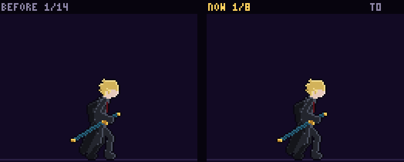

[0.5배속](oscar-idle-compare-half.gif) · [끝점 경로](oscar-idle-path.png) · [실루엣 띠](oscar-idle-sil.png)

- **바꾼 것**: 들숨 시작 → 들숨(머묾) → 날숨 시작 → 엄지가 날밑에 닿음(2틱) → 날숨에 날밑을 밀어 칼날 2px(머묾) → '탁' 다시 밀어 넣음 → 고개를 한 번 끄덕이며 제자리. 숨 한 바퀴 72틱 그대로.
- **일곱 요소**: 해당 없음 — 공격이 아님
- **프레임 수**: 8장. 숨마다 한 장.

### 32. 낙하 `oscar/fall` — 12 → 6프레임 (36틱), B (복사·간격) → A

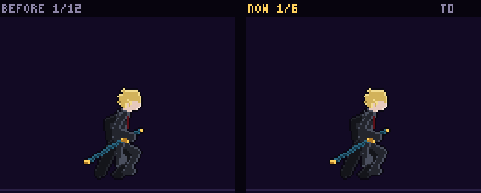

[0.5배속](oscar-fall-compare-half.gif) · [끝점 경로](oscar-fall-path.png) · [실루엣 띠](oscar-fall-sil.png)

- **바꾼 것**: 접은 다리(꼭대기에 오래 머묾) → 무릎이 살짝 풀림 → 다리가 한 번에 펴짐 → 발을 뻗어 땅을 찾음 → 발을 벌려 착지 준비 → 빨리 떨어지면 무릎을 더 굽힘.
- **일곱 요소**: 해당 없음 — 공격이 아님
- **프레임 수**: 6장. 떨어지는 속도로 프레임을 고르는 동작이라 dur 합 36 그대로.

### 33. 착지 `oscar/land` — 12 → 5프레임 (12틱), B (복사·모두 1틱·간격) → A

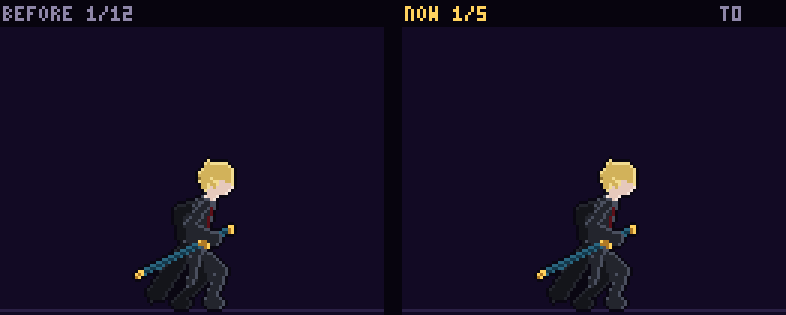

[0.5배속](oscar-land-compare-half.gif) · [끝점 경로](oscar-land-path.png) · [실루엣 띠](oscar-land-sil.png)

- **바꾼 것**: 닿음 → 무릎으로 받아 가장 낮게(고개가 숙음) → 일어나기 시작 → 고개를 들며 일어섬 → 기본자세.
- **일곱 요소**: 해당 없음 — 공격이 아님
- **프레임 수**: 5장(착지 길이를 프레임 수로 고르게 나누는 동작).

### 34. 공중 대시 `oscar/air_dash` — 12 → 6프레임 (12틱), B (복사·모두 1틱) → A

[0.5배속](oscar-air_dash-compare-half.gif) · [끝점 경로](oscar-air_dash-path.png) · [실루엣 띠](oscar-air_dash-sil.png)

- **바꾼 것**: 꼭대기 → 그림자 속으로 몸을 숙여 들어감 → 몸을 눕혀 미끄러짐 → 다리가 더 끌리며 길게 늘어짐 → 몸을 일으켜 나옴 → 낙하 준비.
- **일곱 요소**: 해당 없음 — 공격이 아님
- **프레임 수**: 6장(12틱을 프레임 수로 고르게 나누는 동작). 같은 미끄러짐 자세 7장 대신.

### 35. 방어 막힘 `oscar/guard_hit` — 12 → 5프레임 (12틱), B (복사·모두 1틱) → A

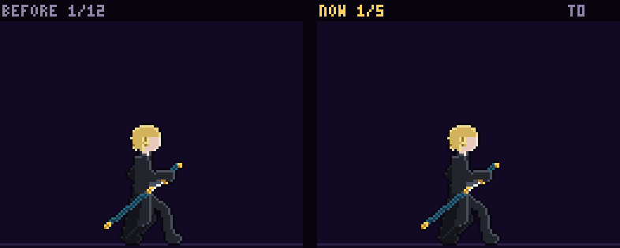

[0.5배속](oscar-guard_hit-compare-half.gif) · [끝점 경로](oscar-guard_hit-path.png) · [실루엣 띠](oscar-guard_hit-sil.png)

- **바꾼 것**: 막힌 순간(칼 6px) → 한 번 더 크게 밀려 등이 젖혀지고 고개가 들림(칼 8px) → 무릎으로 받아 내려앉음 → 버텨 숙임 → 막기 자세.
- **일곱 요소**: 해당 없음 — 공격이 아님
- **프레임 수**: 5장(막힌 경직 길이를 프레임 수로 고르게 나누는 동작).

### 36. 등장 `oscar/intro` — 14 → 14프레임 (112틱), B (간격) → A

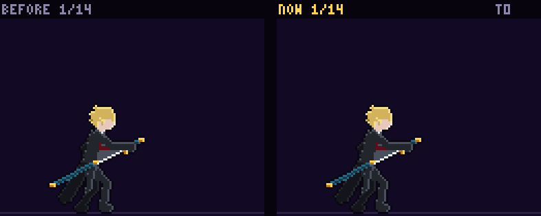

[0.5배속](oscar-intro-compare-half.gif) · [끝점 경로](oscar-intro-path.png) · [실루엣 띠](oscar-intro-sil.png)

- **바꾼 것**: 같은 자세를 두 장씩 늘어놓던 서 있기·'탁'을 한 장으로: 틈이 닫히는 동안 서 있음 → 칼끝을 칼집 입구로 → 천천히 납도 → 칼날 5px를 남기고 멈춤 → 1틱 긴장 → 남은 칼날이 한 번에 미끄러져 들어가 '탁'(100틱, 렌더의 101틱 칼자루 반짝 그대로) → 대기 자세.
- **일곱 요소**: 해당 없음 — 공격이 아님
- **프레임 수**: 14장 그대로. 틈 0~36틱(숨김)·세 걸음 36~70틱 그대로.

## 이펙트 확인

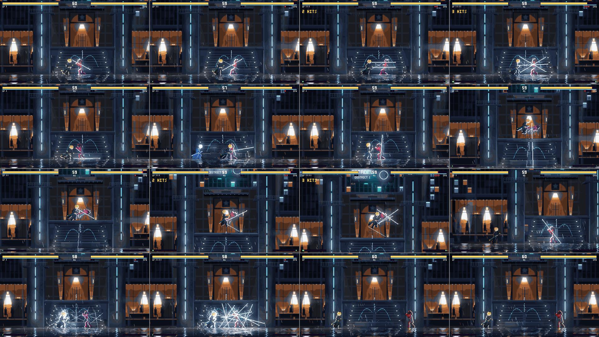

I recorded 8 scenes as gameplay footage (ground hits 1–4, sweep·dash attack, launcher·air hits 1–3, slam, skill 1, charge, entrance, movement). None had page errors, and the cut lines appear in the same tick as the new pose's blade glint. Row by row from the top:

1. **Ground hits 1–4** (`oscar_ground`): in the 1-tick frame where the blade shows (4 ticks, hit 4 is 10 ticks at the '탁'), the cut line appears all at once in the empty space ahead. 1 is a diagonal down-cut, 2 is an X with the opposite angle, 3 is two horizontal lines, 4 is three lines at once (9–12).
2. **Sweep · dash attack · launcher · slam** (`oscar_low`·`oscar_air`·`oscar_slam`): sweep is a horizontal line hugging the ground while crouched low, dash attack is a long line ahead of the path it slid along, launcher is a vertical line the moment he looks up, slam is a vertical line splitting down to the ground the moment he looks down (13–17).
3. **Air hits 1–3 · skill 1** (`oscar_air`·`oscar_skill1`): air 1 is a down-cut as he bends forward, air 2 is an up-cut as the body opens upward, air 3 is the X as he twists, and skill 1 turns the dotted line at the opponent's position solid in the 18-tick blade glint (2·3·16·18).
4. **Charge · entrance** (`oscar_charge`·`oscar_intro`): when the charge releases, the blade comes half out (26 ticks) and the bloom cut bundles open (28 ticks). In the entrance, the '탁' (100 ticks) comes at the end of the slow sheathe, and the small silver glint on the hilt shows up as before at 101 ticks (20·36).

## 도구

- **`tools/revise.mjs`**: 오스카 기술은 관절 판정 차이를 재지 않습니다. 판정이 발밑 기준 베기 선이라(sim이 직접 냄) 그림 관절과 무관합니다. 전에는 기본 스틱맨 기술의 관절(limb)을 물려받아 쓰지 않는 상자를 쟀습니다.

## 알아 두실 것

1. **착지·공중 대시·방어 막힘은 dur로 박자를 줄 수 없습니다.** sim과 렌더가 상태 길이를 프레임 수로 고르게 나누는 동작들이라(앞 캐릭터들과 같음), 프레임마다 다른 자세를 두어 간격을 만들었습니다. 표시 틱은 뷰어·시트용입니다.
2. **평타가 7~10장으로 짧아졌습니다.** 같은 자세를 늘어놓던 프레임을 빼고 길이는 dur로 옮겼습니다. 칼날이 비치는 틱(= 선이 생기는 틱)·총 틱은 그대로라 게임 박자는 같습니다.
3. **스킬·차지·필살기 발동은 16~17장입니다.** 오스카는 정지가 많아 장수를 줄이고 싶을 수 있지만, 스킬 참고값 16~30에 맞춰 표식·모으기를 기다리는 동안 "눈을 가늘게 → 뒷손이 칼집으로 → 엄지가 날밑으로 → 숨" 같은 작은 동작을 한 장씩 두었습니다. 더 적게(정지 위주로) 원하시면 번호로 말씀해 주세요.

