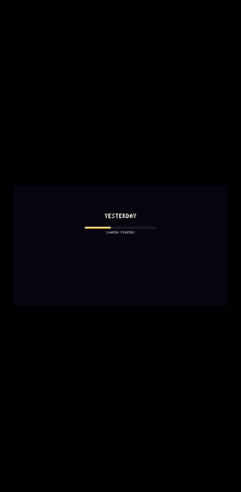

# 렉 고침: 시작 화면 불러오기 막대 + 대련 중 멈춤 없애기 (전후 측정)

## 한눈에

| | PC | 휴대폰 (Pixel 7 에뮬레이션 + CPU 4배 느리게) |
| --- | --- | --- |
| 페이지를 열어 타이틀이 움직이기까지 | 38.1초 → **14.8초** (불러오기 막대 12.6초) | 163초 → **51.6초** (불러오기 막대 48.3초) |
| 대련(라운드) 시작: 50ms 넘는 "처음 만드는 일" 멈춤 | 4번 (가장 긴 것 0.33초) → **0번** | 3번 (가장 긴 것 1.35초) → **0번** |
| 기술을 처음 쓸 때 (네 캐릭터 합) | 84번 (가장 긴 것 0.91초, 합 25.9초) → **1번** (메모리 정리 57ms) | 101번 (가장 긴 것 4.3초, 합 134.7초) → **9번** (모두 필살기로 건물·구조물이 부서지는 순간) |
| 그 밖에 50ms 넘는 평소 프레임 | 2번 (51·55ms) → 1번 (오스카 필살기 마무리 102ms) | 아래 '평소 프레임' 참고 (이 측정 환경 탓이 크다) |

> **정정 (2차에서 확인)**: 이 문서의 '대련 시작' 측정은 측정 도구가 메뉴 키를 한 번 더 눌러, 대련이 이미 시작되고 약 1.5초 지난 뒤부터 기록했다(대련 장면이 처음 만들어지는 순간이 빠졌다).
> 순서를 고쳐 다시 재면 "처음 만드는 일" 멈춤은 예전 main PC 7번(가장 긴 것 0.51초)·휴대폰 8번(1.88초) → 1차 PC 0번·휴대폰 1번(첫 대련 화면 텍스처 올리기가 든 155ms)이다.
> 자세한 것은 [loading-2.md](loading-2.md) 3장.

## 잰 방법 (고치기 전과 똑같이)

- 대상: 고치기 전 = 최신 main(`1f88c66`), 고친 뒤 = 이 브랜치. 둘 다 `vite build --sourcemap`으로 빌드해 정적 서버로 띄웠다.
- 도구: Playwright + Chrome 성능 추적(CPU 표본 포함). 메인 스레드에서 50ms 넘게 걸린 작업(RunTask)을 원본 파일·함수로 나눴다.
- 이 컨테이너에는 그래픽 칩이 없어 3D를 CPU로 그린다(SwiftShader). 그래서 프레임마다 200~300ms의 "GPU 대기"가 생긴다.
  이것은 측정 환경 탓이라 표의 숫자는 모두 **GPU 대기를 뺀 실제 일**이다 (고치기 전 측정과 같은 기준).
- 세 순간: ① 페이지를 처음 열 때 ② 대련이 시작될 때 (타이틀 → VERSUS CPU → 라이덴 vs 라이덴 → EASY)
  ③ 캐릭터마다 기술을 하나씩 처음 쓸 때 (연습 모드: 걷기 → 1~4타 → 쓸기 → 띄우기 → 대시 공격 → 공중 1~3타 → 내려찍기 → 차지 → 스킬 1·2 → 필살기 연출).
- "처음 만드는 일" = 동작 시트·캔버스·셰이더·텍스처·정점 버퍼·소리·메모리 정리가 한 작업에서 20ms 넘게 든 것. 나머지는 "평소 프레임".

## 전후 표

### PC

| 순간 | 50ms 넘는 일 (전 → 후) | "처음 만드는 일" 멈춤: 수 / 가장 긴 것 / 합 (전 → 후) | 남은 것 | 평소 프레임 50ms 넘음: 수 / 가장 긴 것 (전 → 후) |
| --- | --- | --- | --- | --- |
| 대련 시작 | 4 → **0** | 4 / 325ms / 811ms → **0** | — | 0 → 0 |
| 라이덴 첫 기술 | 17 → **0** | 16 / 514ms / 3716ms → **0** | — | 1 / 55ms → 0 |
| 백은우 첫 기술 | 23 → **0** | 23 / 796ms / 6513ms → **0** | — | 0 → 0 |
| 에드워드 첫 기술 | 21 → **0** | 21 / 906ms / 10362ms → **0** | — | 0 → 0 |
| 오스카 첫 기술 | 25 → **2** | 24 / 528ms / 5276ms → 1 / 57ms | 메모리 정리 48ms (걷는 중) | 1 / 51ms → 1 / 102ms (필살기 마무리에 건물·구조물이 부서지는 순간) |

### 휴대폰

| 순간 | 50ms 넘는 일 (전 → 후) | "처음 만드는 일" 멈춤: 수 / 가장 긴 것 / 합 (전 → 후) | 남은 것 | 평소 프레임 50ms 넘음: 수 / 가운데값 / 가장 긴 것 (전 → 후) |
| --- | --- | --- | --- | --- |
| 대련 시작 | 24 → 21 | 3 / 1351ms / 3907ms → **0** | — | 21 / 62ms / 109ms → 21 / 63ms / 83ms |
| 라이덴 첫 기술 | 257 → 157 | 20 / 2266ms / 20853ms → **0** | — | 237 / 69ms / 283ms → 157 / 60ms / 97ms |
| 백은우 첫 기술 | 253 → 155 | 24 / 3640ms / 31752ms → **0** | — | 229 / 79ms / 210ms → 155 / 65ms / 183ms |
| 에드워드 첫 기술 | 291 → 160 | 24 / 4326ms / 49255ms → **1** / 202ms | 필살기로 구조물이 부서질 때 부서진 면 텍스처 올리기 108ms | 267 / 68ms / 257ms → 159 / 58ms / 140ms |
| 오스카 첫 기술 | 289 → 126 | 33 / 3841ms / 32865ms → **8** / 431ms / 1377ms | 필살기 마무리에 건물이 무너진 뒤 약 2초: 떨어지는 조각 층·부서진 정면 텍스처를 프레임마다 올리기 (첫 프레임 431ms, 나머지 106~154ms) | 256 / 73ms / 269ms → 118 / 61ms / 134ms |

#### 휴대폰의 '평소 프레임'이 50ms를 넘는 이유

이 측정 환경에서는 3D를 CPU로 그려 화면 한 장에 250ms쯤 걸린다. 그 사이 게임은 밀린 틱을 최대 6개 한꺼번에 돌리므로
(1초 60틱 고정) 한 작업에 틱 여러 개 + 그리기가 들어가 50~80ms가 된다. 처음 쓰는 것과 상관없이 늘 그렇다
(같은 기술 순서를 두 번 돌리면 두 번째도 같은 수가 나온다).
그래픽 칩이 있는 휴대폰처럼 "화면 한 장 = 틱 하나 + 그리기"로 재면 (rAF 시각을 1/60초씩 넘김, 대련 시작 측정과 같은 순서):

| 프레임 265장 | 가운데값 | 90% | 99% | 가장 긴 것 | 50ms 넘음 |
| --- | --- | --- | --- | --- | --- |
| 실제 일 | 34ms | 47ms | 60ms | 76ms | 17장 (라운드 소개 중 무대 갱신·메모리 정리) |

즉 CPU가 4배 느린 휴대폰에서는 처음 쓸 때 멈추는 일은 사라졌지만, 프레임마다 30~40ms가 드는 것 자체(초당 30장 안팎)는 남아 있다.
주된 몫은 three.js 그리기 호출(`render/gl/view.ts`), 2D 이펙트 층을 텍스처로 올리기(`render/gl/actors.ts`), 기력·차지 오라(`vfx/power-up.ts`)다.

## 불러오기 시간 (단계별)

| 단계 | PC | 휴대폰 |
| --- | --- | --- |
| 화면 (WebGL) | 0.2초 | 0.9초 |
| 무대(맵)·텍스처 (부품 15단계) | 1.8초 | 8.0초 |
| 무너질 때 떨어지는 건물 조각 그림 | 0.1초 | 0.8초 |
| 캐릭터 그림 (네 캐릭터 × 대련에 나오는 모든 동작) | 2.7초 | 11.8초 |
| 그림 모음 텍스처 올리기 | 0.05초 | 0.2초 |
| 셰이더·텍스처 미리 만들기 (두 품질) | 3.5초 | 5.8초 |
| 소리 미리 풀기 | 0.15초 | 0.35초 |
| 이펙트 미리 그려 보기 (라이덴·백은우·에드워드·오스카) | 3.8초 | 19.9초 |
| **합 (막대가 도는 시간)** | **12.6초** | **48.3초** |

막대가 뜨기 전(스크립트 읽기)은 PC 1.0초, 휴대폰 1.7초. 셰이더 단계는 이 환경이 그래픽을 CPU로 만들어 실제 기기보다 길 수 있다.
대련 주소로 바로 열면(확인 도구) 그 두 캐릭터만 그려 더 짧다. `?rehearse=0`이면 이펙트 미리 그려 보기를 건너뛴다.

## 그림이 그대로인지

- 동작 그림: 5가지 겉모습 × 동작 220개 = **12,265프레임이 예전과 픽셀까지 같다** (색 번호 비교).
  예전 방식(긴 띠에 차례로 그리기)의 버릇까지 같게 했다: 뒤 프레임마다 다시 돌던 외곽선 처리 횟수, 띠 기준 좌표의 반올림, 소수 반지름 원.
- `npm run sheets` 출력(PNG·GIF 15개): 예전 main과 바이트까지 같다.
- 무대 고정 지점 5곳(극장·다이너, 광장, 아파트, 성벽 둘) × 품질 높음·낮음: 0~42px 차이 — 예전 빌드끼리도 실행마다 나는 정도(빗줄기·빛 번짐이 프레임 간격에 따라 쌓인다).
- 대련 화면 (CPU끼리, 같은 시드, 15틱마다): 라이덴 vs 백은우 40장 중 39장 같고 1장 1px. 에드워드 vs 오스카 60장 중 55장 같고 5장 9~67px —
  **에드워드가 64px 칸 끝에 닿는 프레임의 테두리 빛 1~2줄**이다 (예전에는 칸 밖을 옆 프레임 그림으로 읽어 테두리 빛이 빠졌고, 지금은 빈칸으로 읽는다).
- 오스카 연습(필살기로 건물이 무너지는 데까지 108장): 10장에서 52px 이하 차이. 예전 빌드는 같은 순서를 두 번 돌려도 107장이 1천~2천px씩 달라지고, 새 빌드는 두 번 돌려 완전히 같다.
- `npm run simtest` 통과 (sim은 바꾸지 않았다). `npm run hitcompare`·`motioncheck` 결과는 main과 같다.

## 바뀐 것 (동작)

- 시작 화면에 불러오기 막대가 생겼다. 그동안 틱은 돌지 않는다 (확인 도구는 틱을 기다리므로 그대로 쓴다).
- 새 경기마다 캐릭터 연출 모듈에 남은 상태(백은우 나비·실·낙인, 에드워드 직전 상태, 오스카 영역)를 처음으로 되돌린다. 예전에는 다시 하기 때 지난 경기 것이 남았다.
- 소리 컨텍스트를 불러오기 화면에서 (멈춘 채) 만든다. 켜는 것은 예전처럼 첫 입력 때다.

## 아직 남은 것과 다음 제안

1. **필살기로 건물·구조물이 한꺼번에 부서지는 순간** (PC 1번 102ms, 휴대폰 오스카 8번·에드워드 1번): 맞은 자리에 따라 부서진 모양을 그 자리에서 짓고 칠해
   텍스처로 올린다(`render/gl/wreck.ts`·`collapse.ts`, 건물 정면 손상, 떨어지는 조각 2D 층). 미리 만들 수 없는 부분이라, 줄이려면 떨어지는 조각을 3D(인스턴스)로 그리거나
   부서진 면을 작은 조각 텍스처로 나눠 올리는 쪽으로 바꿔야 한다.
2. **휴대폰 평소 프레임 30~40ms**: 위 세 몫(three.js 그리기 호출, 2D 이펙트 층 올리기, 오라)을 줄이는 작업.
3. **휴대폰 불러오기 48초**: 이펙트 미리 그려 보기(20초)와 캐릭터 그림(12초)이 크다. ① 그림을 웹 워커 여러 개에서 나눠 그리기 ② 그린 결과를 브라우저에 저장(두 번째부터 거의 0초)
   ③ 이펙트 미리 그려 보기를 타이틀 화면 뒤에서 이어 하기 — 셋 다 큰 결정이라 먼저 여쭙는다.
   → ①·③은 2차에서 했다: [loading-2.md](loading-2.md).
