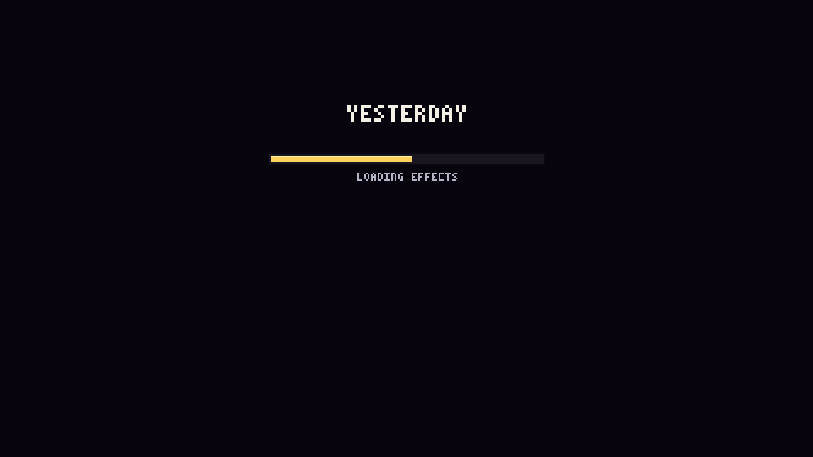

# 불러오기 줄이기 2차: 캐릭터 그림은 그림 일꾼으로, 이펙트 미리 그려 보기는 타이틀 뒤로

1차(렉 고침, [README.md](README.md))에서 생긴 시작 화면 불러오기 막대를 줄였다. 고른 두 가지:

1. **캐릭터 그림을 웹 워커(그림 일꾼)로**: 화면 스레드가 무대를 만드는 동안 일꾼 여럿(기기 코어 수 − 1, 최대 4)이 캐릭터 그림을 나눠 그린다.
2. **이펙트 미리 그려 보기를 타이틀 뒤로**: 막대에서 빼서, 타이틀·메뉴 화면이 도는 동안 프레임마다 8ms씩 이어 한다.
   캐릭터를 고르면 그 캐릭터부터 한다. 대련을 시작할 때 그 두 사람 몫이 남았으면 짧은 막대(LOADING EFFECTS)로 마저 한다.

## 한눈에

| | 예전 main | 1차 (PR 48) | **2차 (이번)** |
| --- | --- | --- | --- |
| PC: 페이지를 열어 타이틀이 움직이기까지 (불러오기 막대) | 38.1초 | 14.8초 (12.6초) | **10.1초 (7.8초)** |
| 휴대폰: 같은 것 | 163초 | 51.6초 (48.3초) | **23.8초 (19.5초)** |
| PC: 대련 시작 (EASY를 누른 뒤) "처음 만드는 일" 멈춤 | 7번 (가장 긴 것 0.51초) | 0번 | **0번** (짧은 막대 안의 67ms 한 번은 막대가 떠 있는 동안) |
| 휴대폰: 같은 것 | 8번 (가장 긴 것 1.88초) | 1번 (첫 대련 화면 텍스처 올리기 155ms) | **0번** (짧은 막대 안의 일은 아래) |
| 첫 대련 시작 때 짧은 막대 | 없음 | 없음 | PC 약 0.6초, 휴대폰 약 6~7초 (타이틀에 머문 시간에 달림, 아래 3장. 두 번째 대련부터는 없음) |

휴대폰 = Pixel 7 에뮬레이션 + CPU 4배 느리게 (1차와 같다). 이 컨테이너에는 그래픽 칩이 없어 3D를 CPU로 그리므로 셰이더 단계와 타이틀 프레임이 실제 기기보다 느리다.

## 1. 페이지를 열 때 (불러오기 막대, 단계별)

| 단계 | PC 1차 → 2차 | 휴대폰 1차 → 2차 |
| --- | --- | --- |
| 그림 일꾼 보내기 (새 단계) | — → 0.003초 | — → 0.01초 |
| 화면 (WebGL) | 0.2 → 0.5초 | 0.9 → 1.1초 |
| 무대(맵)·텍스처 (부품 15단계) | 1.8 → 3.0초 | 8.0 → 9.8초 |
| 무너질 때 떨어지는 건물 조각 그림 | 0.1 → 0.16초 | 0.8 → 1.1초 |
| 캐릭터 그림 | 2.7 → **0.001초** (일꾼 3개가 무대를 만드는 동안 2.6초에 끝냄) | 11.8 → **0.005초** (일꾼 3개, 5.3초에 끝냄 — 아래 주의) |
| 그림 모음 텍스처 올리기 | 0.05 → 0.04초 | 0.2 → 0.3초 |
| 셰이더·텍스처 미리 만들기 | 3.5 → 3.8초 | 5.8 → 6.0초 |
| 소리 미리 풀기 | 0.15 → 0.14초 | 0.35 → 0.48초 |
| 이펙트 미리 그려 보기 | 3.8초 → **타이틀 뒤로** | 19.9초 → **타이틀 뒤로** |
| **합** | **12.6 → 7.8초** | **48.3 → 19.5초** |

- 무대 단계가 조금 길어진 것(PC +1.2초, 휴대폰 +1.8초)은 같은 때 일꾼들이 CPU를 나눠 쓰기 때문이다. 그만큼 캐릭터 그림 2.7초·11.8초가 통째로 빠졌다.
- **휴대폰 일꾼 시간 주의**: 이 측정 도구(Chrome의 CPU 느리게 하기)는 화면 스레드만 느리게 하고 일꾼은 느리게 하지 못한다.
  실제 휴대폰에서는 일꾼도 느리다. PC 일꾼 시간 2.6초의 4배(약 10.4초)로 쳐도 캐릭터 그림 단계가 시작하는 때(불러오기 시작 뒤 약 12.0초)보다 먼저 끝나므로
  **기다림은 0초로 어림**한다. 코어가 적거나 바쁜 휴대폰이면 몇 초 기다릴 수 있다. 일꾼을 못 쓰는 브라우저는 예전처럼 화면 스레드에서 그린다(1차의 11.8초).
- 그림이 그대로인지: 일꾼이 그린 그림 모음(텍스처 2장)과 화면 스레드가 그린 것의 해시가 같다(`62c9ee50`).

## 2. 타이틀 화면 뒤의 이펙트 미리 그려 보기

- 타이틀·메뉴 화면 프레임마다 8ms씩 한다 (그동안은 빛 품질 자동 조절을 재지 않는다: 느려진 프레임 탓에 품질이 내려가지 않게).
- 화면 효과 상태(물들이기·배경 누르기·어긋남 등)는 미리 그려 보기가 돌 때만 바꿔 끼우고 끝나면 되돌린다. 타이틀 화면은 그대로 보인다(타이틀 캡처로 확인).
- 차례: 라이덴 → 백은우 → 에드워드 → 오스카. 내 캐릭터·상대를 고르면 그 둘을 앞으로 당긴다.
- 대련을 시작할 때 두 사람 몫이 남았으면 짧은 막대로 마저 하고, 다른 캐릭터의 하다 만 몫은 처음부터 다시 한다(실제 대련이 캐릭터 연출 상태를 새로 시작하므로).
  한 번 끝낸 캐릭터는 다시 하지 않으므로 **두 번째 대련부터는 막대가 없다**.

### 타이틀 화면이 얼마나 무거워지나

타이틀에 가만히 두고 PC 20초·휴대폰 30초를 기록했다 (프레임마다 GPU 대기를 뺀 실제 일). `?rehearse=0`(미리 그려 보기 없음)과 비교:

| | 가운데값 | 90% | 99% | 가장 긴 것 | 50ms 넘음 | 그동안 한 몫 |
| --- | --- | --- | --- | --- | --- | --- |
| PC 없음 | 4ms | 7ms | 11ms | 11ms | 0 | — |
| PC 미리 그려 보기 중 | 14ms | 23ms | 42ms | 47ms | **0** | 네 사람 합의 28% (20초) |
| 휴대폰 없음 | 18ms | 36ms | 52ms | 59ms | 2 | — |
| 휴대폰 미리 그려 보기 중 | 28ms | 51ms | 94ms | 153ms | **18** (30초 중) | 네 사람 합의 9.5% (30초) |

- 프레임마다 약 10ms가 더 든다(8ms 몫 + 넘침). 틱 하나를 그리는 도중에는 끊을 수 없어서, 필살기 이펙트처럼 무거운 틱에서는 한 프레임이 길어진다.
- **휴대폰에서는 타이틀이 가끔(이 측정에서 30초에 18번) 0.05~0.15초 멈칫한다.** 대련 중이 아니라 타이틀·메뉴 화면이고, 네 사람 몫을 다 하면 사라진다.
  (실제 휴대폰에서 네 사람 몫은 일 약 25초 → 타이틀·메뉴에 1~1분 30초쯤 머물면 끝난다고 어림한다. 대련 중에는 하지 않고, 대련에서 타이틀로 돌아오면 남은 것을 이어 한다.)
- 이 환경은 타이틀 한 장을 그리는 데 GPU 대기 200~300ms가 들어 초당 몇 장밖에 안 나오므로, 그동안 한 몫(위 표 오른쪽 칸)은 실제 기기보다 훨씬 적다.

## 3. 대련 시작 (측정 순서를 고친 다시 재기)

**1차 보고의 '대련 시작' 측정이 잘못되어 있었다.** 측정 도구가 메뉴에서 키를 한 번 더 눌러, 네 번째 누름(EASY)에서 이미 대련이 시작된 뒤 약 1.5초가 지나서야 기록을 켰다.
그래서 대련 장면이 처음 만들어지는 순간이 빠져 있었다. 순서를 고쳐(타이틀 → VERSUS CPU → RAIDEN → RAIDEN → 1.5초 → 기록 시작 → EASY) 세 빌드를 다시 쟀다.
범위: EASY를 누른 순간부터 라운드 소개(등장·ROUND 1·FIGHT)가 끝나고 2초 뒤까지. 숫자는 GPU 대기를 뺀 실제 일.

| | 예전 main | 1차 | 2차 |
| --- | --- | --- | --- |
| PC: "처음 만드는 일" 멈춤 (수 / 가장 긴 것 / 합) | 7 / 506ms / 1610ms (누른 직후 동작 시트 205ms + 라운드 소개 중 동작 시트 6번) | 0 | 대련 중 **0** · 짧은 막대 안 1 / 67ms |
| PC: 누른 뒤 대련이 움직이기까지 | 1.6초 | 1.4초 | 2.1초 (짧은 막대 약 0.6초 포함) |
| 휴대폰: "처음 만드는 일" 멈춤 | 8 / 1878ms / 6848ms (동작 시트·캔버스) | 1 / 155ms (첫 대련 화면 텍스처 올리기 41ms) | 대련 중 **0** · 짧은 막대 안의 미리 그려 보기 프레임 21번 55~360ms (이펙트 그리기) |
| 휴대폰: 누른 뒤 대련이 움직이기까지 | 2.8초 | 1.6초 | 8.5초 (짧은 막대 약 6.5초 포함) |
| 휴대폰: 그 밖에 50ms 넘는 평소 프레임 (막대 프레임 빼고) | 24번 / 가장 긴 것 130ms | 17번 / 111ms | 24번 / 105ms |

- 휴대폰 평소 프레임이 50ms를 넘는 것은 1차 보고와 같은 이유(이 환경은 3D를 CPU로 그려 프레임마다 밀린 틱을 몰아 돈다)이고, 처음 쓰는 것과 상관없다.
- **짧은 막대 시간은 타이틀에 머문 시간에 달려 있다.** 이 측정은 타이틀이 뜬 뒤 메뉴를 다 고르기까지 타이틀에 약 10초(PC)·약 12초(휴대폰) 머물렀다.
  - PC: 그동안 라이덴 몫의 57%를 타이틀 뒤에서 끝내, 막대는 약 0.6초 (바로 골라도 약 0.5초).
  - 휴대폰(에뮬레이션): 그동안 19%밖에 못 해 막대가 약 6.5초 (기록을 끄고 타이틀이 뜨자마자 골라 재면 약 5.5초). 이 환경은 타이틀 한 프레임이 3D를 CPU로 그리느라 약 250ms라
    8ms씩 하는 미리 그려 보기가 1초에 약 0.03초 몫밖에 못 한다. **그래픽 칩이 있는 실제 휴대폰은 타이틀이 초당 수십 장이라 1초에 약 0.3~0.5초 몫을 한다**(어림).
    라이덴 한 명 몫은 휴대폰에서 일 약 6~7초(이번 막대 측정에서 어림)이므로, 타이틀·메뉴에 15~25초쯤 머물면 막대 없이 시작하고, 바로 고르면 약 6~7초(서로 다른 두 캐릭터면 그 두 배까지) 막대가 뜬다.
  - 그래도 "페이지를 열고 첫 대련이 움직이기까지" 합은 휴대폰에서 1차보다 짧다: 1차 51.6초 + 메뉴 → 2차 23.8초 + 메뉴 + 막대 (한 사람이면 최대 약 7초, 두 사람이면 약 14초).
- 짧은 막대 안에서는 한 프레임에 12ms씩 하지만, 필살기 이펙트처럼 한 틱을 그리는 데 오래 걸리는 곳에서 막대 프레임이 길어진다(휴대폰 가장 긴 것 360ms). 막대 화면이 잠깐 멈칫하는 것일 뿐 대련 중 멈춤은 아니다.

## 4. 대련 중 처음 쓰는 기술 (달라지지 않았는지)

휴대폰 백은우 연습(1차와 같은 순서: 걷기 → 1~4타 → … → 필살기 연출)을 1차 빌드와 이번 빌드로 같은 때 연달아 쟀다.

| | 1차 빌드 | 2차 빌드 |
| --- | --- | --- |
| "처음 만드는 일" 멈춤 | 1번: 1~4타 117ms (이펙트 층 텍스처 올리기 40ms) | 2번: 스킬 1 88ms (메모리 정리 25ms), 필살기 192ms (건물 정면이 부서져 텍스처 다시 올리기 60ms) |
| 50ms 넘는 평소 프레임: 수 / 가운데값 / 가장 긴 것 | 202 / 69ms / 250ms | 223 / 70ms / 200ms |

- 두 빌드가 같은 정도다. 경계에 걸친 한두 개는 잴 때마다 바뀐다(1차 보고 때 1차 빌드는 0번이었다).
  필살기의 건물 정면 텍스처는 1차 보고의 '아직 남은 것 1'(필살기로 건물·구조물이 부서지는 순간)과 같은 것으로, 필살기가 건물에 닿느냐에 따라 나오거나 안 나온다.
- 이번에 바꾼 것은 대련 중에는 돌지 않는다: 일꾼이 그린 그림은 화면 스레드가 그린 것과 같고, 미리 그려 보기는 타이틀·불러오기 막대에서만 돈다.

## 확인한 것

- `npm run build`(타입 검사 포함) 통과, `npm run simtest` 모두 통과 (sim은 바꾸지 않았다).
- 그림 모음 해시가 일꾼 사용·미사용(`?workers=0`, 화면 스레드에서 그리기)에서 같다.
- 타이틀 화면: 미리 그려 보기가 도는 중(15%·50%·80% 지점)에 찍은 화면이 평소 타이틀과 같다(물들이기·확대 같은 대련 효과가 새지 않는다).
- 대련 주소로 바로 열면(확인 도구) 예전처럼 불러오기 막대 안에서 그 두 사람 몫을 다 한다. `?rehearse=0`이면 미리 그려 보기를 하지 않는다.

## 다음 제안 (큰 결정이라 먼저 여쭙는다)

1. **휴대폰에서 바로 고르면 뜨는 첫 대련 시작 막대(약 6~7초)와 타이틀의 가끔 멈칫**: ① 타이틀 프레임이 빨리 끝나면 남는 시간만큼 더 하기(타이틀 프레임 수는 그대로) ② 미리 그려 보기 순서를 줄여(같은 이펙트를 두 번 그리는 곳 빼기) 일 자체를 줄이기.
2. **그린 결과를 브라우저에 저장**(두 번째 방문부터 캐릭터 그림·셰이더 거의 0초): 1차 때 고르지 않은 것. 원하면 한다.
3. 셰이더 단계(PC 3.8초·휴대폰 6.0초)는 이 환경이 그래픽을 CPU로 만들어 길게 나온다. 실제 기기에서 따로 재 보면 좋다.
