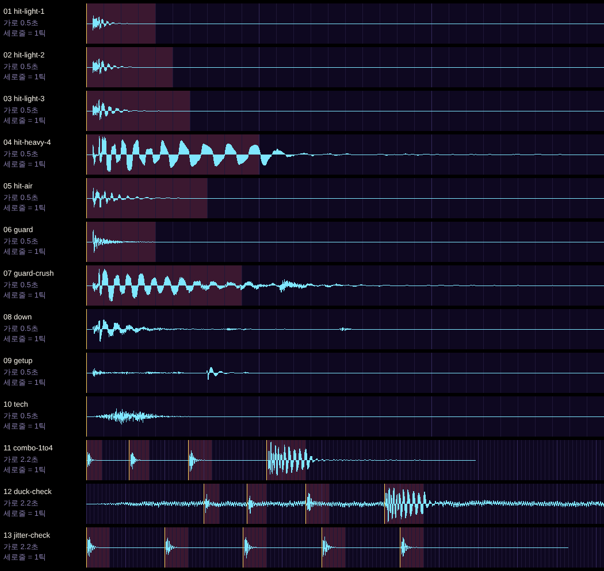

# 소리 미리듣기 (npm run sound가 만든다)

번호로 답해 주세요 (예: "3 더 묵직하게"). 휴대폰에서는 파일을 누른 뒤 **View raw**(또는 다운로드)를 누르면 재생됩니다.
배포된 게임에서는 타이틀 → OPTIONS → SOUND TEST에서 같은 번호로 바로 들을 수 있습니다.

모두 코드로 합성 (Web Audio). 모노 22kHz 16비트. 첫 소리는 파일 첫머리에서 바로 시작합니다.
길이 = 리버브를 뺀 소리가 피크보다 40dB 낮아질 때까지. 저음 비중 = 200Hz 아래 에너지 비율. 울림 = 소리가 끝난 직후 남는 리버브 꼬리 크기(피크 대비).

| 번호 | 소리 | 들어 볼 것 | 길이 (목표) | 저음 비중 | 울림 | 파일 |
| --- | --- | --- | --- | --- | --- | --- |
| 1 | 약하게 맞음 1타 | 라이덴 1타. 짧은 노이즈 탁 + 낮은 클릭 히트스톱 4틱 | 42ms (40~80) | 21% | -46dB | [01-hit-light-1.wav](01-hit-light-1.wav) |
| 2 | 약하게 맞음 2타 | 1타보다 저음이 깊고 꼬리가 조금 길다 히트스톱 5틱 | 55ms (40~80) | 34% | -46dB | [02-hit-light-2.wav](02-hit-light-2.wav) |
| 3 | 약하게 맞음 3타 | 2타보다 더 깊고 길다 히트스톱 6틱 | 65ms (40~80) | 48% | -46dB | [03-hit-light-3.wav](03-hit-light-3.wav) |
| 4 | 세게 맞음 4타 | 낮은 쿵 + 노이즈 폭발 + 꼬리. 쿵이 히트스톱 동안 이어지고, 히트스톱이 풀리는 순간 꼬리가 시작 히트스톱 10틱 | 213ms (150~250) | 94% | -30dB | [04-hit-heavy-4.wav](04-hit-heavy-4.wav) |
| 5 | 공중에서 맞음 | 세게 맞음보다 가볍고 높게 (공중 1타) 히트스톱 7틱 | 126ms (100~140) | 52% | -43dB | [05-hit-air.wav](05-hit-air.wav) |
| 6 | 가드 | 짧은 금속성 울림 히트스톱 4틱 | 63ms (60~100) | 6% | -45dB | [06-guard.wav](06-guard.wav) |
| 7 | 가드 크러시 | 유리 깨지는 소리 + 저음 히트스톱 9틱 | 288ms (250~350) | 85% | -35dB | [07-guard-crush.wav](07-guard-crush.wav) |
| 8 | 다운 | 젖은 바닥에 떨어지는 철퍽 (내려찍기로 튈 때, KO로 떨어질 때도) | 255ms | 55% | -42dB | [08-down.wav](08-down.wav) |
| 9 | 기상 | 바닥을 짚고 일어나는 가벼운 찰박 | 158ms | 60% | -38dB | [09-getup.wav](09-getup.wav) |
| 10 | 낙법 | 짧은 바람 | 103ms | 2% | -43dB | [10-tech.wav](10-tech.wav) |
| 11 | 1→4타 이어 듣기 | 라이덴 1~4타를 실제 sim으로 맞혀 잰 틱 간격 그대로 소리 4개, 시작 틱 0·11·26·46 | — | — | — | [11-combo-1to4.wav](11-combo-1to4.wav) |
| 12 | 강타 덕킹 확인 | 시험용 바닥 소리(빗소리 아님) 위에서 1→4타. 4타의 히트스톱 동안 바닥 소리가 9dB 낮아졌다 돌아온다 덕킹 -9.3dB (히트스톱 10틱 동안), 풀린 뒤 1.6dB 소리 4개, 시작 틱 30·41·56·76 | — | — | — | [12-duck-check.wav](12-duck-check.wav) |
| 13 | 흔들림 확인 | 3타를 20틱마다 5번. 매번 피치(±3.5%)·길이(±6%)가 조금씩 다르다 소리 5개, 시작 틱 0·20·40·60·80 | — | — | — | [13-jitter-check.wav](13-jitter-check.wav) |

